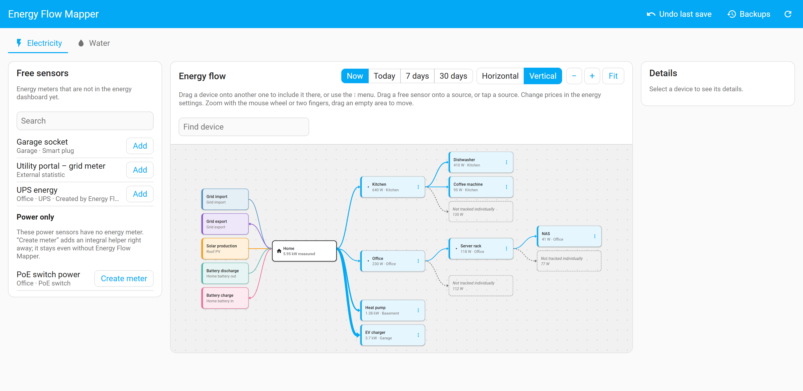
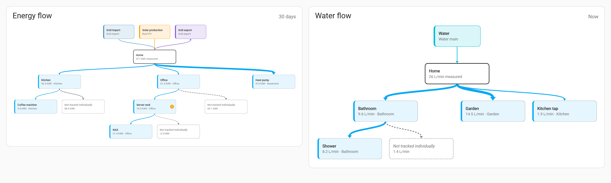

# Changelog

All notable changes to this project are documented here. The format follows
[Keep a Changelog](https://keepachangelog.com/en/1.1.0/), and the project uses
[Semantic Versioning](https://semver.org/). Before 1.0, minor releases may contain
breaking changes; they are marked as **Breaking**.

Each version starts with its highlight and ends with the Home Assistant release it was
tested with. The section of a version is also the text of its GitHub release, which HACS
and Home Assistant show when they offer the update.

## [Unreleased]

### 📦 Changed

- **More room for the diagram on phones:** the diagram now fills the screen below the
  tabs and the search. The tools sit behind "Tools ▾" and the help text behind "?".
- **Select mode** shows in the bar at the bottom as long as it is on, with "Done" to leave
  it, also before the first block is picked.
- **Tap a group to open it:** the whole block opens or closes a group, not just the small
  arrow; its actions (rename, dissolve, sum meter) are behind ⋮, as with devices.
- **Discard asks first** when the draft has more than one change.
- **Sum meter:** the dialog warns when an entity with that name already exists.

### 🐛 Fixed

- **Device names like Home Assistant (2026.11):** a device without its own name no longer
  gets the device it talks through in front of its name, such as the Zigbee stick
  ("Home Assistant Connect ZBT-2 Plug Aquarium"). As in Home Assistant's energy dashboard,
  only a child device without its own area gets its parent device in front.
- **Removing the home meter could remove the grid:** when the home meter and the grid
  import are the same sensor, "Remove as source" on one no longer removes the other (and
  with it the grid's prices).
- **Restoring an older backup could block saving:** a backup only holds the lists that
  changed back then. If restoring it would now add errors (for example a sensor that is
  both a source and a device), nothing is written and the panel says why. Undoing the
  last save always brings back the settings you had.
- **Groups of devices removed outside the mapper came back** when the device was added
  again later. Saving now also tidies the stored groups.
- **Group names:** duplicate or blank names from a damaged store or an import file are
  cleaned up (blank ones dropped, repeated ones numbered), and names are compared without
  surrounding spaces.
- **A new energy source type** that a future Home Assistant adds no longer leaves the
  panel blank.
- **Bottom bar on phones:** in the companion app on Android with on-screen navigation
  buttons, the bar with the selection or the unsaved changes sat behind the buttons. It
  now keeps clear of them, only where the phone has them. Messages no longer cover its
  buttons or swallow taps, the selection count is no longer cut off, and a disabled
  "Group" says why.
- **Dialogs on phones** fit the screen, long names without spaces wrap, messages show
  inside an open dialog instead of behind it, and "Checking …" can be cancelled.
- **Save as image** no longer cuts off the line below small diagrams, such as the gas tab.
- **Home meter "not current enough" for Today** is only shown when its data really is too
  old, not whenever it has no value.
- **A meter helper that failed half way** is removed again, so creating it can be tried
  again.
- **Draft preview:** using a device added or renamed in the draft as the home meter keeps
  its power sensor and name, as the save does.
- **Dashboard card:** emptying the title in the editor hides the header, as the label
  says. A failed refresh keeps the last diagram with a small hint. A card hidden by a
  visibility condition starts at Home and loads fresh values when it is shown. The start
  field is called "Start at", and groups with the same name show their parent.
- **German:** "Strg+Klick" instead of "Ctrl+Klick".
- **Development:** `scripts/deploy.sh` only copies the files by default and never restarts
  Home Assistant. The release script also checks the card files in the ZIP. The bug report
  form lists groups, sum meters, the water and gas tabs and the dashboard card.

## [0.9.0] - 2026-11-11

> **Highlight:** bring order to big trees – fold devices into groups, turn any group into a
> real sum meter, and give gas its own tab. Your unsaved draft now survives leaving the
> panel.

### ✨ Added

- **Gas tab:** gas has its own tab with your gas meters. Assign, replace and remove them
  like water meters; the price and other settings of a replaced meter stay. Each meter
  shows its flow now and its use in a period, in m³ (ft³ with US units) or kWh. Home
  Assistant has no gas devices, so there is nothing to arrange below them.
- **Your draft survives leaving the panel:** unsaved changes are kept in the browser and
  come back when you open the panel again, with the same undo steps, also after a save
  that ran into a conflict. If the energy settings were changed in the meantime, the
  draft is dropped with a message.
- **Groups:** bundle devices of the same parent into named groups in the Electricity and
  Water tabs, and nest groups at any depth. Select blocks (Ctrl/Cmd+click, or *Select* on
  a phone), then *Group*. A collapsed group is one block with the sum of its members; an
  expanded group is a labelled frame. Saved groups start collapsed; a group you expanded
  or created stays open when the panel reloads. Drag devices and groups in and out,
  rename or dissolve a group, or let *Suggest groups from areas* make a start (one group
  per parent and area with at least two ungrouped children). Groups are part of the draft:
  undo, check, one save, backup, restore, export and import (export format version 2;
  version 1 files are still accepted). They are display only and change nothing in the
  energy settings. When a removed device brings two groups of the same name below one
  parent, the moved group gets a number, like *Kitchen (2)*.
- **Sum meters:** *Create sum meter* turns a group, or sensors you pick, into a real meter:
  a Home Assistant sum helper (sensor group, *ignore non-numeric* off, so a member that
  is briefly unavailable makes the sum unavailable instead of dropping). The members move
  below the new meter in the draft. A power or flow sum is created too, only when every
  device in the sum has a power or flow sensor. Mixed Wh and kWh members are converted by
  Home Assistant; members with different state classes are refused. Undoing the draft
  leaves the created helpers in place. This covers a sub panel that measures net of its
  own solar (a gross meter = sub panel + solar).
- **Groups on the dashboard card:** the card shows groups, collapsible by tapping, and
  `root` also accepts a group (`group:<id>`) to show only that group; the card editor
  lists the groups.
- **Clearer when saving is not possible:** the bar at the bottom says how many problems
  prevent saving. The check before saving marks problems that are already in the saved
  settings, and *Show* takes you to the block.

### 📦 Changed

- **Gas is no longer shown in the electricity tab** or on the electricity card. It looked
  as if gas flowed into Home there, but it was never counted in the home consumption.

*Tested with Home Assistant 2026.10.4 and 2026.11.1 · minimum 2026.10.0*

## [0.8.0] - 2026-11-07

> **Highlight:** see at a glance what is wrong and what is missing – Home Assistant's own
> checks right at the device, how much of Home your devices cover, and suggestions where
> they belong. Save the diagram as an image to share it.

### ✨ Added

- **Home Assistant's own checks at the block:** what Home Assistant's energy settings
  report (sensor unavailable, entity gone, wrong unit or state class, negative state,
  excluded from the recorder) is marked at the device, source or home meter, in Home
  Assistant's own words. Also on the dashboard card, without anything about prices.
- **Coverage at Home:** *72% covered by devices*, switchable with *Coverage* above the
  diagram; on the card with the option `show_coverage` (off by default).
- **Suggestions from child devices:** where an integration registers a device as part of
  another one, the panel suggests including it there. *Apply* puts the move into the
  draft, *Ignore* hides the suggestion for every admin (stored in Home Assistant),
  *Show ignored suggestions again* brings them back. Only Home Assistant's child devices
  count, never how a device is connected.
- **Save as image:** the whole diagram of the tab as a PNG, with the period and the date;
  *Hide names* turns devices into *Device 1, 2, …* and leaves out areas and sensor names.

### 🐛 Fixed

- Without a home meter, Home no longer shows a negative sum of the devices (for example
  after a meter was reset); it shows no measured value instead.

*Tested with Home Assistant 2026.10.4 and 2026.11.0 · minimum 2026.10.0*

## [0.7.0] - 2026-11-04

> **Highlight:** see what your whole home uses – and how much of it no device covers yet.
> With Home Assistant 2026.11, assign the new home meter right at Home.

### ✨ Added

- **Home meter** (Home Assistant 2026.11 or newer): assign, replace or remove the whole-home
  meter at Home – drop a free sensor on *+ Home meter* or tap it. A device that is your
  main meter can become the home meter in one step (*Use as home meter*); its child devices
  move up a level, and it keeps its name.
- **Home consumption** at Home: measured by the home meter, or for a period calculated
  from grid, solar and battery. Below Home, *Untracked consumption* shows what no
  top-level device covers, with a warning when the devices use clearly more than the home.
  This also works on Home Assistant 2026.10, without a home meter.
- Meters whose data is hours behind (for example from a utility portal) give no home value
  instead of a misleading one; Home names the meter.
- The same on the dashboard card.

### 📦 Changed

- Terms like in Home Assistant: *upstream device*, *child devices* and *untracked
  consumption* (before: parent device, sub-devices, not tracked individually), in all four
  languages.
- With Home Assistant 2026.11 or newer, a device without its own name is named after its
  device (with the upstream device in front), the same way the energy dashboard does it.

*Tested with Home Assistant 2026.10.4 and 2026.11.0 · minimum 2026.10.0*

## [0.6.0] - 2026-11-04

> **Highlight:** large energy trees stay readable – switch the diagram to vertical, and
> find Energy Flow Mapper directly in HACS.

### ✨ Added

- **Vertical diagram** for large energy trees: the buttons *Horizontal* and *Vertical*
  above the diagram run the tree top-down or from left to right, with the devices of a
  level stacked below each other. Your browser remembers the choice.
- Card option `orientation` (`horizontal` or `vertical`), also in the card editor.

### 📦 Changed

- Energy Flow Mapper is in the HACS default list now: search for it in HACS. The README
  keeps the custom repository steps as a fallback.

*Tested with Home Assistant 2026.10.4 and 2026.11.0b5 · minimum 2026.10.0*

## [0.5.0] - 2026-10-25

> **Highlight:** a dashboard card for everyone – your device tree, read-only, on any
> dashboard.

### ✨ Added

- **Dashboard card** `custom:energy-flow-mapper-card`: the device tree of electricity or
  water on any dashboard, read-only and for every user. Period (now, today, 7 or 30
  days), start at a device, sources and untracked consumption on or off, title; tap a
  device to open its history. Set up in the card editor; it comes with the integration
  without adding a resource.
- A read-only command for the card, which users who are not admins may use too. It
  returns the tree, names and consumption only, never prices or costs.

*Tested with Home Assistant 2026.10.4 · minimum 2026.10.0*

## [0.4.0] - 2026-10-25

> **Highlight:** water meters from flow sensors, undo in the draft, and a search for big
> diagrams.

### ✨ Added

- "Create meter" for flow sensors without a water meter in the Water tab: an integral
  helper that counts litres (or the unit of the flow) and is shown as water.
- "Undo change" in the bar at the bottom, and Ctrl+Z, take back the last change of the
  draft.
- "Find device" above the diagram: matching devices are highlighted, collapsed parents
  open, and Enter moves from match to match.

### 🐛 Fixed

- A zoom made before the diagram had its size is no longer replaced by the first fit.
- The diagram fits into the window again; since the tabs came in 0.3.0 it reached
  below the bottom edge.

*Tested with Home Assistant 2026.10.4 · minimum 2026.10.0*

## [0.3.0] - 2026-10-25

> **Highlight:** water joins electricity – its own tab for water devices and water meters.

### ✨ Added

- **Water** tab: the water devices of the energy dashboard as their own diagram, edited
  like electricity devices (include, move to the top level, rename, remove, add free
  water meters and external volume statistics with their flow sensor).
- Water meters as sources: assign, replace (prices stay) and remove.
- Flow now, and water per period in litres and m³ (gallons with US units). Warnings
  when sub-devices used more than 5 % and 10 L more than their device.
- Export and import include the water devices; files exported with 0.2.0 still import
  and leave the water devices as they are.
- HACS installs the release ZIP (`zip_release`), so the download count of a release
  shows roughly how often it was installed.

*Tested with Home Assistant 2026.10.4 · minimum 2026.10.0*

## [0.2.0] - 2026-10-24

> **Highlight:** your energy settings as a file – export, import, and as many backups as
> you like.

### ✨ Added

- Option "Backups to keep" (5 to 100, default 20) under Settings → Devices & services →
  Energy Flow Mapper → Configure.
- Export of the current energy sources and devices, or of any backup, as a JSON file from
  the Backups dialog.
- Import of such a file: it is checked like a draft, the changes are shown for
  confirmation, and the current settings are backed up first.
- README section about where backups are kept and how they get into Home Assistant
  backups.

*Tested with Home Assistant 2026.10.3 · minimum 2026.10.0*

## [0.1.0] - 2026-10-23

> **Highlight:** first public beta – the energy dashboard as a diagram you can edit by
> drag and drop.

### ✨ Added

- Admin panel **Energy Flow Mapper** in the sidebar that shows the energy dashboard
  configuration as a diagram: sources, Home and devices as blocks, arranged
  automatically, with arrows from each device to the devices it includes. Zoom and move
  with the mouse wheel, by dragging or with two fingers.
- Live power and energy per period (now, today, 7 days, 30 days): blocks, Home and arrow
  widths follow the value; devices with sub-devices show the consumption that is not
  tracked individually.
- Plausibility warnings when sub-devices used clearly more energy than their device
  (more than 5 % and 0.1 kWh).
- Edit by drag and drop or the ⋮ menu: include a device in another one, move it to the
  top level, rename or remove it. While dragging, valid targets are highlighted.
- Free sensors: unused energy meters and external energy statistics (e.g. from energy
  supplier portals) can be added as devices.
- Sources: drag a free sensor onto grid import, grid export, solar or battery, or tap a
  source to assign, replace or remove its sensor. Prices of the grid connection stay.
  Gas and water sources are shown only.
- Meters for power sensors without an energy meter: "Create meter" adds an ordinary
  integral helper (it keeps working without Energy Flow Mapper) and puts it into the
  draft; helpers created by the panel are labelled.
- Changes are collected in a draft, checked (loops, missing parents, duplicates, a
  sensor used as source and device or by two sources, and what Home Assistant itself
  would reject) and saved in one step after a confirmation. Every save stores a backup
  first (the last 20 are kept); "Undo last save" and "Backups" restore an earlier state.
- Saving is refused when the energy settings were changed elsewhere in the meantime;
  the panel reloads and keeps the draft.
- Repair issue and disabled editor when the energy settings of the Home Assistant
  release are not supported.
- Diagnostics with counts only (no entity names).
- English, German, French and Italian; light and dark theme; phone layout.

*Minimum Home Assistant 2026.10.0*
