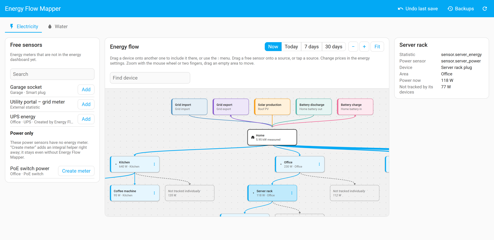
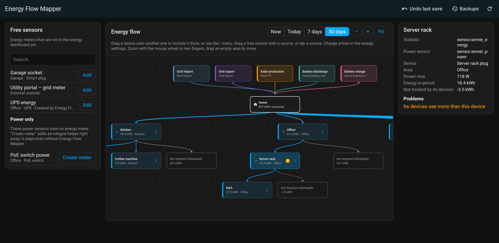
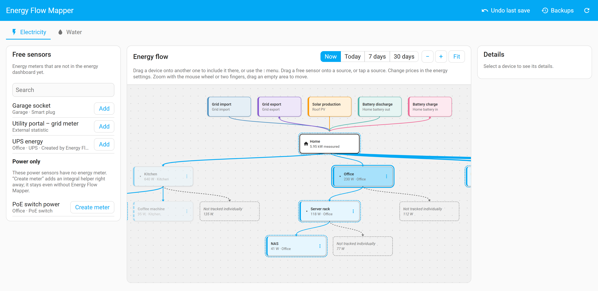
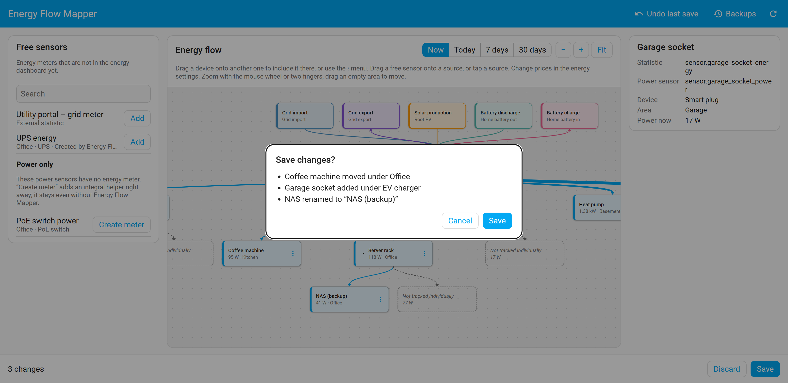
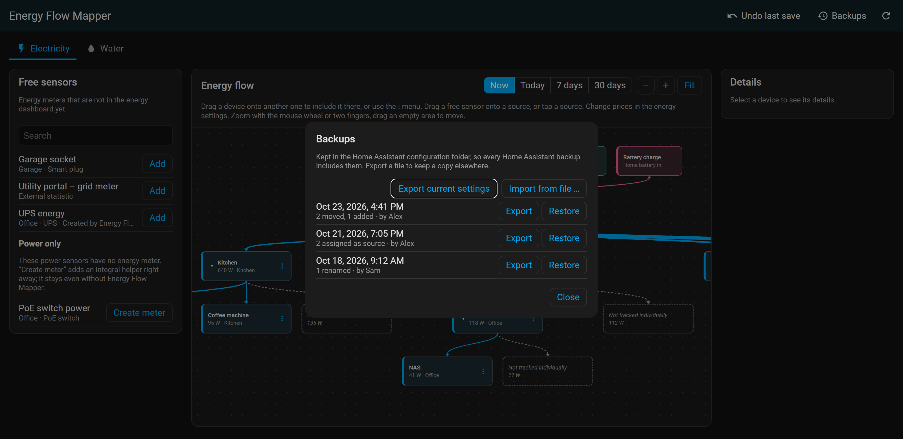
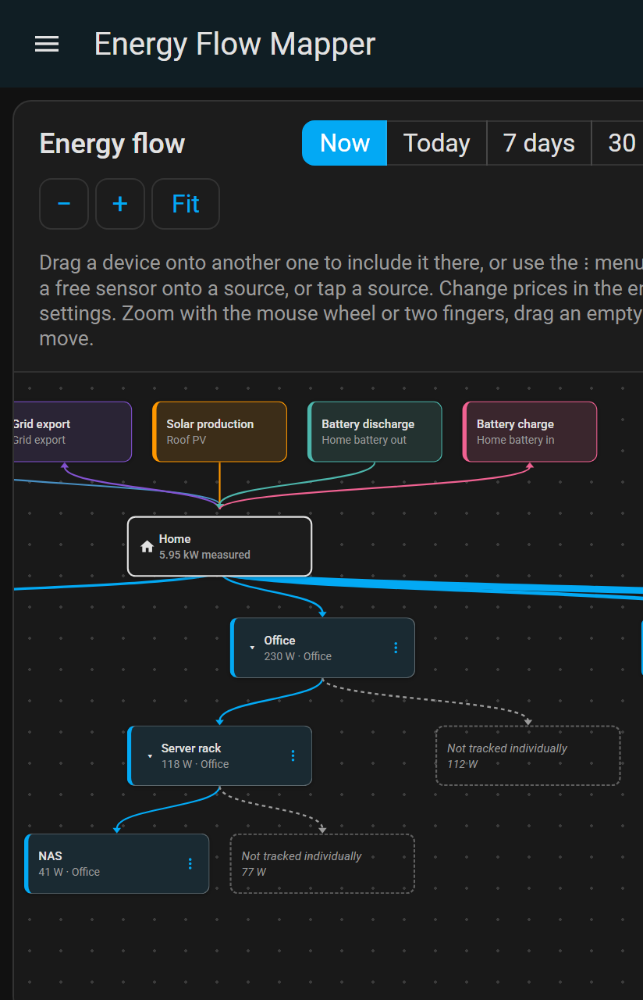
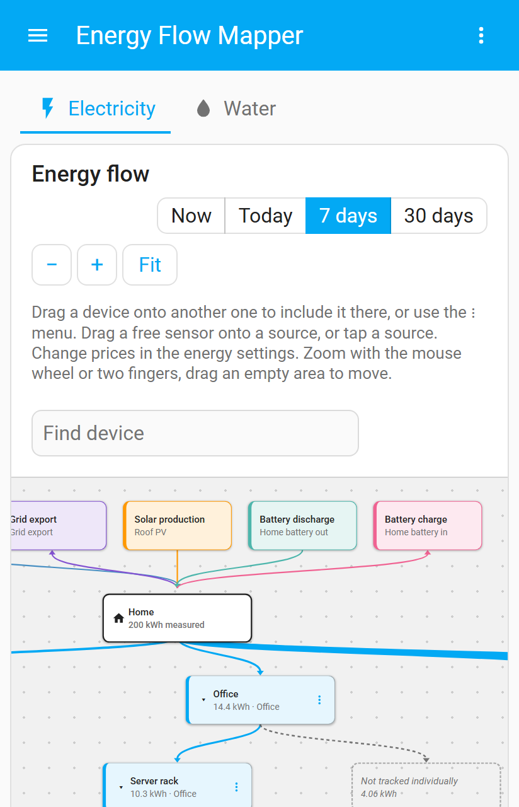

# Energy Flow Mapper

Not another energy card – a visual editor that maps your sensors into the Home Assistant
energy dashboard.

Energy Flow Mapper adds an admin panel to Home Assistant. It shows your energy
configuration as a diagram – sources at the top, your home in the middle, devices below –
and lets you change it by drag and drop: which device is included in which, which sensor
is your grid import, export, solar or battery meter, and which energy meters are not used
yet.

> **Beta.** Breaking changes are possible before 1.0. Every save keeps a backup of your
> previous energy settings, so you can always go back.

<picture>
  <source media="(prefers-color-scheme: dark)" srcset="docs/images/diagram-dark.png">
  
</picture>

## Features

- **Diagram of your energy dashboard:** sources, Home and devices as blocks, arranged
  automatically; arrows show which device is included in which. Zoom and move with the
  mouse wheel, by dragging or with two fingers.
- **Live power and energy per period:** switch between now, today, 7 days and 30 days.
  Arrow widths follow the value; every device with sub-devices shows the consumption
  that is *not tracked individually*.
- **Plausibility warnings:** a device is flagged when its sub-devices used clearly more
  energy than it did (more than 5 % and 0.1 kWh) – usually a wrong assignment.
- **Edit by drag and drop** (or with the ⋮ menu on phones): include a device in another
  one, move it to the top level, rename or remove it.
- **Free sensors:** energy meters and external statistics (e.g. from energy supplier
  portals) that are not in the energy dashboard yet; add them with one drag.
- **Sources:** drop a sensor onto grid import, grid export, solar or battery. Existing
  prices and compensations of your grid connection stay as they are.
- **Meters for power sensors:** for power sensors without an energy meter (a UPS, PoE
  ports, …) "Create meter" adds an ordinary integral helper and puts it into the diagram.
- **Safe saving:** changes are collected in a draft and checked (loops, missing parents,
  duplicates, a sensor used twice) before anything is written. Every save first stores a
  backup; "Undo last save" and "Backups" restore an earlier state.
- **English, German, French and Italian**, light and dark theme, phone layout.

## Screenshots

| | |
|---|---|
|  |  |
| *30 days:* energy per device, consumption not tracked individually and a warning | *Drag and drop:* the possible targets are highlighted |
|  |  |
| *Saving:* every change is listed before anything is written | *Backups:* restore an earlier state |

  
  

The screenshots show a demo household.

## Requirements

- Home Assistant **2026.10.0** or newer
- Admin user (the panel and all its commands are admin-only)

## Installation

### HACS (custom repository)

1. In HACS, open ⋮ → **Custom repositories**, add
   `https://github.com/Skylolerr/ha-energy-flow-mapper` with type **Integration**.
2. Search for **Energy Flow Mapper**, download it and restart Home Assistant.

### Manual

Copy `custom_components/energy_flow_mapper` into the `custom_components` folder of your
Home Assistant configuration and restart Home Assistant.

## Setup

Settings → Devices & services → **Add integration** → **Energy Flow Mapper** → Submit.
There is nothing to configure. The setup does not change your energy settings; the panel
**Energy Flow Mapper** appears in the sidebar for admins.

## Using the panel

| To … | Do this |
|---|---|
| Include a device in another one | Drag its block onto the other block, or ⋮ → *Move to …* |
| Move a device to the top level | Drag it onto **Home**, or ⋮ → *Move to …* → *Top level* |
| Add an energy meter as device | Drag it from *Free sensors* into the diagram, or *Add* |
| Assign a source | Drag a free sensor onto *+ Grid import*, *+ Solar*, … or tap the source |
| Replace or remove a source | Tap the source block |
| Get a meter for a power sensor | *Power only* → *Create meter* |
| See energy instead of power | Switch *Now* to *Today*, *7 days* or *30 days* |
| Save | *Save* in the bar at the bottom, check the list of changes, confirm |
| Go back | *Undo last save* or *Backups* → *Restore* |

Good to know:

- **Nothing is written until you save.** The bar at the bottom shows how many changes
  your draft has; *Discard* throws the draft away.
- **"Create meter" acts at once:** the integral helper is created immediately (not on
  save) and appears under Settings → Helpers. It is an ordinary Home Assistant helper and
  keeps working without Energy Flow Mapper; the panel labels helpers it created.
- **Energy values** come from the Home Assistant statistics, like in the energy
  dashboard: *Today* is at most a few minutes old, *7 days* and *30 days* go up to the
  last full hour. New meters only have values from the time they were created.
- If someone changes the energy settings elsewhere while you edit, saving is refused and
  the panel reloads; your draft is kept and checked again.

## How it works

- The energy dashboard configuration of Home Assistant stays the single source of truth.
  Energy Flow Mapper reads it fresh, writes it through the same checks as the energy
  settings page and always sends complete lists, so unrelated settings are kept.
- Backups (the last 20) are stored in `.storage/energy_flow_mapper.backups`, the list of
  helpers created by the panel in `.storage/energy_flow_mapper.helpers`.
- The integration has no entities and no devices.

## Known limitations

- A device can be included in **one** other device only (a Home Assistant rule).
- Prices, costs and solar forecasts are edited in the energy settings of Home Assistant,
  not in the panel.
- Gas and water sources are shown only. Editing them and the water device hierarchy are
  planned for 0.2.0.
- Dragging works with a mouse and with a long press on phones; the ⋮ menu offers the
  same actions.

## Troubleshooting

- **Repair issue "does not support this Home Assistant release":** the energy settings of
  your Home Assistant release do not match what Energy Flow Mapper expects. To protect
  your settings the editor is disabled. Update Energy Flow Mapper or open an issue.
- **Something looks wrong after saving:** use *Undo last save* or restore a backup.
- **Report a problem:** open an [issue](https://github.com/Skylolerr/ha-energy-flow-mapper/issues)
  with the diagnostics (Settings → Devices & services → Energy Flow Mapper → ⋮ →
  Download diagnostics; it contains counts only, no entity names) and the log entries for
  `energy_flow_mapper`.

## Removal

Settings → Devices & services → Energy Flow Mapper → ⋮ → **Delete**, then remove it in
HACS. Your energy settings stay as they are, and helpers created by the panel stay too
(delete them under Settings → Helpers if you no longer need them). The backups are
deleted with the integration.

## Translations

English and German are maintained by the author; French and Italian are new – community
review is welcome.

## License

MIT, see [LICENSE](LICENSE).
