<p align="center">
  <picture>
    <source media="(prefers-color-scheme: dark)" srcset="https://raw.githubusercontent.com/Skylolerr/ha-energy-flow-mapper/main/docs/images/banner-dark.png">
    
  </picture>
</p>

<p align="center">
  <a href="https://hacs.xyz/"></a>
  <a href="https://github.com/Skylolerr/ha-energy-flow-mapper/releases/latest"></a>
  
  <a href="https://github.com/Skylolerr/ha-energy-flow-mapper/actions/workflows/validate.yml"></a>
  <a href="https://github.com/Skylolerr/ha-energy-flow-mapper/actions/workflows/tests.yml"></a>
  <a href="LICENSE"></a>
</p>

<p align="center">
  <a href="https://my.home-assistant.io/redirect/hacs_repository/?owner=Skylolerr&repository=ha-energy-flow-mapper&category=integration"></a>
  <a href="https://my.home-assistant.io/redirect/config_flow_start/?domain=energy_flow_mapper"></a>
</p>

**Not another energy card – a visual editor that maps your sensors into the Home
Assistant energy dashboard.** Energy Flow Mapper shows your energy configuration as a
diagram – sources at the top, your home in the middle, devices below – and lets you
change it by drag and drop: which device is included in which, which sensor is your grid,
solar, battery or water meter, and which meters are not used yet.

> [!NOTE]
> **Beta.** Breaking changes are possible before 1.0. Every save keeps a backup of your
> previous energy settings, so you can always go back.

<p align="center">
  <picture>
    <source media="(prefers-color-scheme: dark)" srcset="https://raw.githubusercontent.com/Skylolerr/ha-energy-flow-mapper/main/docs/images/diagram-dark.png">
    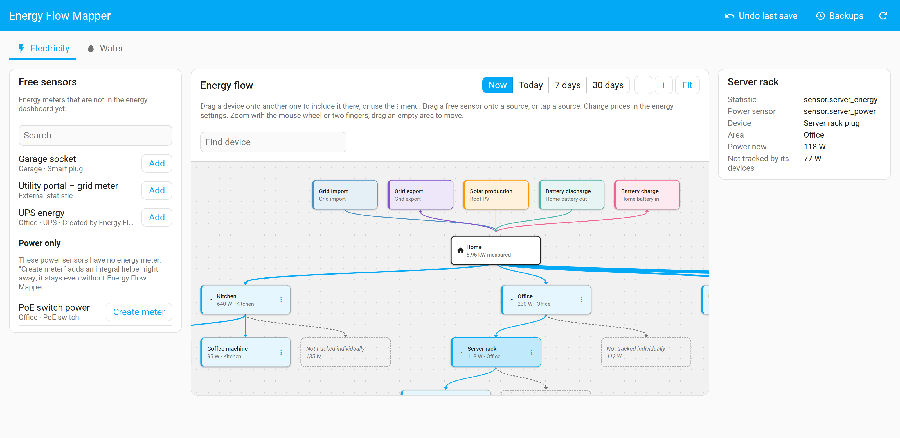
  </picture>
</p>

## See it in action

<table>
  <tr>
    <td width="50%">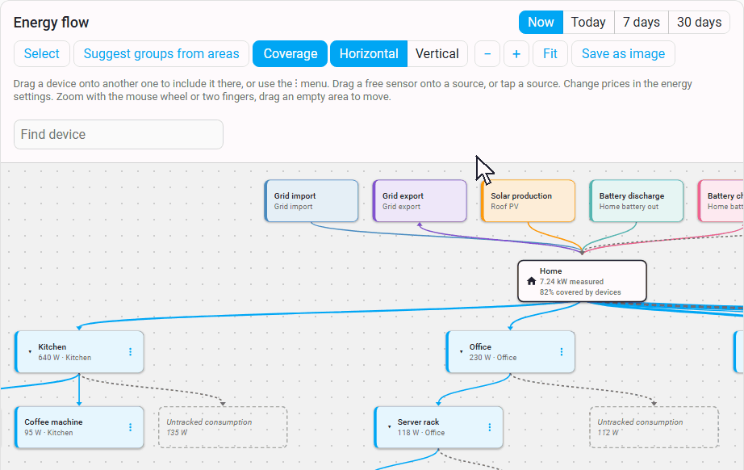</td>
    <td width="50%">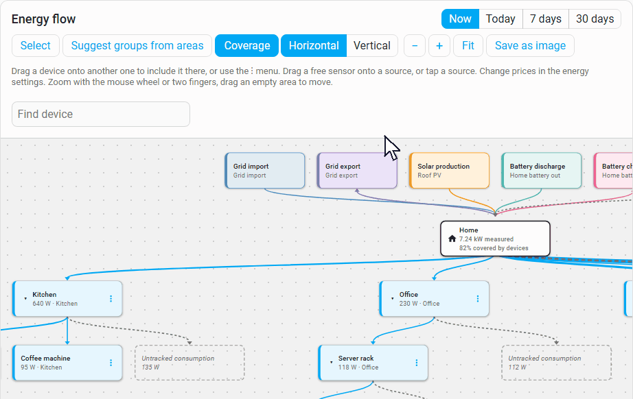</td>
  </tr>
  <tr>
    <td><b>Live and per period.</b> Power now, or energy of today, 7 or 30 days – arrow widths follow the value.</td>
    <td><b>Drag and drop.</b> Drop a device onto another one to include it there; valid targets light up.</td>
  </tr>
  <tr>
    <td colspan="2">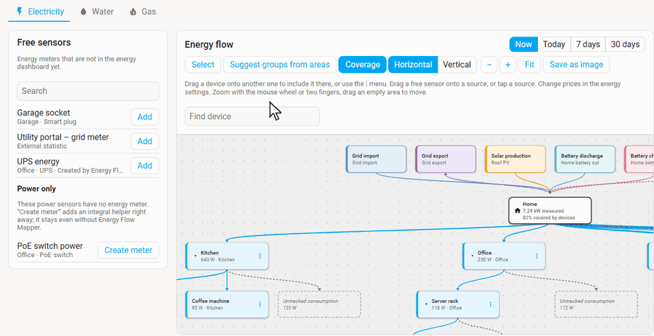</td>
  </tr>
  <tr>
    <td colspan="2"><b>Electricity, water and gas.</b> Each has its own tab with its own meters and free sensors.</td>
  </tr>
  <tr>
    <td colspan="2">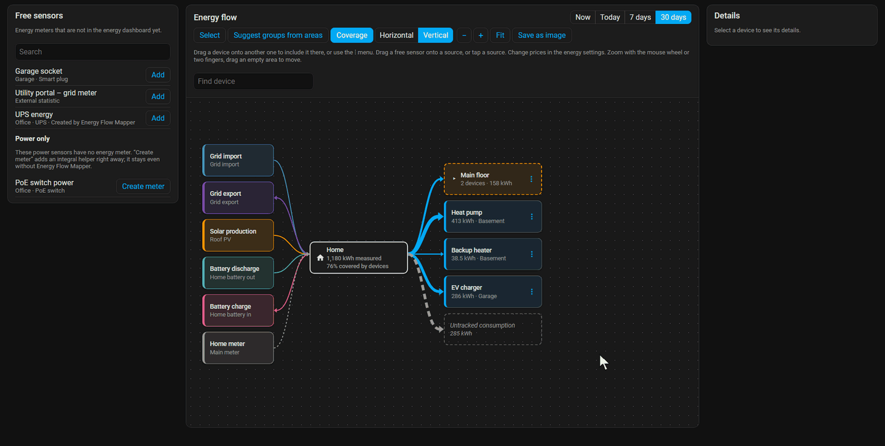</td>
  </tr>
  <tr>
    <td colspan="2"><b>Groups.</b> Select devices, group them, and fold the group into one block with its sum.</td>
  </tr>
</table>

## Features

**See your setup**

- **Diagram of your energy dashboard** – sources, Home and devices, arranged
  automatically; zoom and move with the mouse wheel, by dragging or with two fingers.
  A large tree stays readable: *Vertical* runs it from left to right instead of top-down.
- **Live power and energy per period** – now, today, 7 days or 30 days. Every device with
  child devices shows its *untracked consumption*.
- **The whole home** – Home shows what the house used: measured by a home meter, or
  calculated from grid, solar and battery. Below it, the *untracked consumption* that no device covers yet. With
  Home Assistant 2026.11 or newer you can assign the home meter here too, or turn a
  device into it.
- **Names and terms like Home Assistant** – upstream device, child devices, untracked
  consumption; with Home Assistant 2026.11 or newer, devices are named after their device,
  as in the energy dashboard.
- **Coverage** – Home shows how much of the house the devices cover, for example
  *72% covered by devices*. Switch it off with *Coverage* above the diagram.
- **Mark helpers** (off by default) – *Mark helpers* above the diagram puts a small
  mark at the top left of every meter that is a helper (∫ integral, Σ group, { } template,
  utility meter, other helpers) or an external statistic (a cloud). A device's own sensor
  gets no mark. The details always name the type.
- **Home Assistant's own checks** – what the energy settings of Home Assistant report
  (sensor unavailable, entity gone, wrong unit, …) is marked right at the block, in Home
  Assistant's own words.
- **Plausibility warnings** – a device is flagged when its child devices used clearly more
  than it did (more than 5 % and 0.1 kWh, water 10 L) – usually a wrong assignment.
- **Hints** – a small info mark at a block points out what is easy to miss: a circuit that
  probably has a solar feeding into it, a sum that mixes meters that start again at 0 every
  day with others, a power sensor that the meter's device has but that is not set, and a
  gross meter of *Solar feeds in here…* whose statistics look wrong (see
  [Hints about a gross meter](#hints-about-a-gross-meter)). The details explain it and
  offer a button; *Dismiss* hides a hint for good (a gross meter's hint for that hour or
  day only). Hints only explain, they never change anything, and they show in the panel
  only, not on the card.
- **Find a device** – the search field highlights matches, opens collapsed devices and
  moves to them.
- **Groups** – bundle devices of the same parent into named groups, nested as deep as you
  like. A collapsed group is one block with the sum of its members; expanded, it is a
  labelled frame. Handy for big, flat trees (electricity and water).

**Change it safely**

- **Drag and drop** (or the ⋮ menu on phones) – include a device in another one, move it to
  the top level, rename or remove it.
- **Replace a device** – ⋮ → *Replace with …* puts another meter in a device's place in one
  step: it takes over the parent, the child devices, the group and a name you set.
- **Sources** – drop a sensor onto grid import, grid export, solar, battery, water or gas.
  Prices and compensations of an existing source stay as they are. Each source shows its
  power now (from the power sensor in the energy settings) or its energy in the period.
- **Power sensors** – set or change the power sensor of a device (⋮ → *Power sensor …*,
  water: *Flow sensor …*) or of a source (tap it → *Power sensor …*). Sensors of the
  meter's own device come first. Grid and battery offer the three variants of Home
  Assistant's energy settings – *Standard*, *Inverted* and *Two sensors* – each explained
  in one sentence. The block shows the live value right away, in the draft already.
- **Free sensors** – energy and water meters and external statistics (for example from
  your supplier's portal) that are not in the dashboard yet, added with one drag. Sensors
  that a meter of your settings already contains (an input of its template or sum helper)
  are folded into *Contained in meters*, with the meter they are part of. The arrow in
  the header folds the column to a slim strip when you need more room for the diagram.
- **Meters for power and flow sensors** – "Create meter" turns a power sensor (a UPS, PoE
  ports, …) or a flow sensor into an ordinary integral helper and puts it in the diagram.
- **Suggestions from child devices** – where an integration registers a device as part of
  another one (an outlet of a power strip, a channel of a multi-channel meter), the panel
  suggests including it there. *Apply* puts it into the draft, *Ignore* hides it for every
  admin. Nothing changes by itself, and connections such as a Zigbee stick never count.
- **Sum meters** – *Create sum meter* turns a group (or sensors you pick) into a real Home
  Assistant sum helper that becomes a device in the energy dashboard, with the members
  below it. With a source and exactly one device, *Replace* (with the device's name) is
  preselected: the new meter takes the device's place, because the device is already
  part of the sum. The dialog names members without a power sensor, refuses members that
  start again at 0 now and then and a mix of state classes, and sends a sum with a solar
  to *Solar feeds in here…*.
- **Solar in a circuit** – *Solar feeds in here…* builds the gross meter of a circuit or
  sub panel with a solar behind its meter, by a method that fits the meter, and watches
  it afterwards; see [Solar in a circuit or sub panel](#solar-in-a-circuit-or-sub-panel).
- **Draft, check, save** – changes are collected in a draft and checked (loops, missing
  parents, duplicates, a sensor used twice) before anything is written. A device whose
  meter another device's meter already counts, but that is not placed below it, gets a
  warning. *Undo change*
  takes back a step, and every save stores a backup first. Leave the panel and come back:
  your unsaved draft is still there.

**Everywhere**

- **Dashboard card** – the same tree, read-only, on any dashboard and for every user;
  groups open and close by tapping, and the card can start at a group.
- **Save as image** – the whole diagram as a PNG for a question, a forum post or your own
  records; *Hide names* turns devices into *Device 1, 2, …* and leaves out areas and
  sensor names. The image is made in your browser and sent nowhere.
- **Water tab** – water devices and meters, in litres and m³ (gallons with US units).
- **Gas tab** – your gas meters with their use, in m³ (ft³ with US units) or kWh; assign,
  replace and remove them. Home Assistant has no gas devices, so there is nothing to
  arrange below them.
- **Backups, export and import** – restore any earlier state or keep a copy elsewhere.
- **English, German, French and Italian**, light and dark theme, phone layout.

## Installation

1. **HACS:** open HACS, search for **Energy Flow Mapper**, download it and restart Home
   Assistant. *Open this repository in HACS* above takes you straight there.
2. **Set up:** click *Set up Energy Flow Mapper* above, or Settings → Devices & services →
   **Add integration** → **Energy Flow Mapper**.
3. **Open the panel:** **Energy Flow Mapper** appears in the sidebar for admins. The setup
   itself does not change your energy settings.

Requires Home Assistant **2026.10.0** or newer. The panel is for admins; the dashboard
card is for everyone.

<details>
<summary>As a custom repository</summary>

If HACS does not find it yet, add `https://github.com/Skylolerr/ha-energy-flow-mapper`
under HACS → ⋮ → **Custom repositories** with type **Integration**, then download
**Energy Flow Mapper** and restart Home Assistant.
</details>

<details>
<summary>Manual installation</summary>

Copy `custom_components/energy_flow_mapper` into the `custom_components` folder of your
Home Assistant configuration and restart Home Assistant.
</details>

### Options

Settings → Devices & services → Energy Flow Mapper → **Configure**:

| Option | Default | Meaning |
|---|---|---|
| Backups to keep | 20 | How many backups of your previous energy settings are kept, 5 to 100. If you lower it, the oldest backups beyond the new number are deleted. |

## Dashboard card

<p align="center">
  <picture>
    <source media="(prefers-color-scheme: dark)" srcset="https://raw.githubusercontent.com/Skylolerr/ha-energy-flow-mapper/main/docs/images/card-dark.png">
    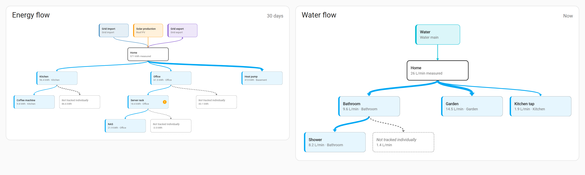
  </picture>
</p>

The card shows a device tree on a dashboard. It only shows – editing stays in the panel –
and every user who can see the dashboard sees it, like Home Assistant's own energy
dashboard. Tap a device to open its history.

Add it in the dashboard editor: *Add card* → search for **Energy Flow Mapper**. It comes
with the integration; there is no resource to add. In YAML:

```yaml
type: custom:energy-flow-mapper-card
kind: electricity      # or water
period: today          # now, today, week or month
root: sensor.kitchen_energy   # optional: only this device (or group:<id>) and everything below it
title: Kitchen         # optional; an empty title hides the header
orientation: vertical  # horizontal (top-down, default) or vertical (left to right)
show_sources: true     # sources before Home (not with root)
show_untracked: true   # blocks for untracked consumption
show_coverage: false   # "72% covered by devices" at Home (electricity, off by default)
show_types: false      # small mark on helpers and external statistics (off by default)
```

A tree wider than the card is shown at half size at least; then the card scrolls
sideways and starts at Home. With many devices, `vertical` keeps the tree narrow and
makes the card taller. Values are read again every minute; power and flow *now* follow
the sensors live.

## Using the panel

| To … | Do this |
|---|---|
| Include a device in another one | Drag its block onto the other block, or ⋮ → *Move to …* |
| Move a device to the top level | Drag it onto **Home**, or ⋮ → *Move to …* → *Top level* |
| Add a meter as device | Drag it from *Free sensors* into the diagram, or *Add* |
| Assign a source | Drag a free sensor onto *+ Grid import*, *+ Solar*, … or tap the source |
| Replace or remove a source | Tap the source block |
| Edit water devices and meters | Open the *Water* tab; everything works as for electricity |
| Assign, replace or remove a gas meter | Open the *Gas* tab; *Add* a free gas meter or tap the meter |
| Get a meter for a power sensor | *Power only* → *Create meter* |
| Get a water meter for a flow sensor | *Water* tab → *Flow only* → *Create meter* |
| Group devices | Ctrl/Cmd+click several blocks (on a phone: *Select*, then tap them) → *Group* → name |
| Add a device to a group | Drag its block onto the group |
| Take a device out of a group | Drag it out of the frame onto its parent |
| Open or close a group | Tap it |
| Rename or dissolve a group | ⋮ on the group → *Rename* or *Dissolve group* (members stay) |
| Group devices by area | *Suggest groups from areas* in the toolbar |
| Create a sum meter | ⋮ on a group → *Create sum meter*, or ⋮ on a device to pick sensors freely |
| Put another meter in a device's place | ⋮ → *Replace with …* → pick the meter |
| Set the power sensor of a device | ⋮ → *Power sensor …* (water: *Flow sensor …*) |
| Set the power sensor of a source | Tap the source → *Power sensor …* (water and gas: *Flow sensor …*) |
| Count a solar that feeds into a circuit | ⋮ on the circuit → *Solar feeds in here…* |
| Read or hide a hint | Tap the block with the info mark; *Dismiss* hides it for good (a gross meter's hint for that event only) |
| Show one group on a dashboard | Card option `root: group:<id>`, or pick the group in the card editor |
| Find a device in a big diagram | Type in *Find device*; Enter goes to the next match |
| Take back a change of the draft | *Undo change* in the bar at the bottom, or Ctrl+Z |
| See energy instead of power | Switch *Now* to *Today*, *7 days* or *30 days* |
| Use a suggestion | Tap the device with the light bulb → *Apply* (or *Ignore*) |
| Bring back ignored suggestions and dismissed hints | *Show ignored suggestions again* in the help line above the diagram |
| Share or keep a picture | *Save as image*, optionally with *Hide names* |
| Save | *Save* in the bar at the bottom, check the list of changes, confirm |
| Go back | *Undo last save* or *Backups* → *Restore* |
| Keep a copy elsewhere | *Backups* → *Export current settings*, or *Export* next to a backup |
| Bring a copy back | *Backups* → *Import from file …*, check the list of changes, confirm |

> [!TIP]
> **Nothing is written until you save.** The bar at the bottom shows how many changes your
> draft has; *Undo change* takes back the last one, *Discard* throws the draft away.

<details>
<summary>Good to know</summary>

- **"Create meter" acts at once:** the integral helper is created immediately (not on
  save) and appears under Settings → Helpers. It is an ordinary Home Assistant helper and
  keeps working without Energy Flow Mapper; the panel labels helpers it created. Undoing
  the change in the draft does not delete the helper; it stays a free sensor. A water
  meter counts in the unit of the flow (L/min gives litres, m³/h gives m³) and is shown
  as water, so the energy dashboard accepts it.
- **Energy values** come from the Home Assistant statistics, like in the energy
  dashboard: *Today* is at most a few minutes old, *7 days* and *30 days* go up to the
  last full hour. New meters only have values from the time they were created.
- If someone changes the energy settings elsewhere while you edit, saving is refused and
  the panel reloads; your draft is kept and checked again.
- **Groups exist only in Energy Flow Mapper.** Home Assistant's energy dashboard does not
  know them; it only sees a sum meter as a normal device. Groups are display only and are
  stored in `.storage/energy_flow_mapper.groups`; they are included in backups and in
  exports.
- **Sum meters act at once, too:** the helpers are created immediately (not on save) and
  appear under Settings → Helpers; undoing the draft leaves them in place. They are Home
  Assistant sum helpers with *ignore non-numeric* off. Mixed Wh and kWh members are
  converted by Home Assistant; members with different state classes are refused (the
  dialog lists each member's class), and so are external statistics (a helper cannot sum
  them). A power or flow sum is created only when every member is a device with a power
  or flow sensor. A source in the sum keeps the power or flow sum from being created (the
  sign of grid and battery power depends on the direction, and a water source's flow
  cannot join a flow sum); the dialog says so. A solar never goes into a sum: see
  [Sum meters and solar](#sum-meters-and-solar).
- **Meters that start again at 0 every day** (the daily energy of many micro inverters,
  utility meters with a cycle, meters whose `last_reset` changes) are recognised: a meter
  that fell towards 0 – to less than half of the value before, from above or from
  below 0 – on at least 2 of the last 3 days. A fall that the meter's own power sensor
  explains (a circuit exporting near 0) is no reset; without a power sensor, the fall must
  be more than twice the meter's usual fall. In a sum, such a meter would make the sum drop at
  each of its resets, and Home Assistant would count the whole sum again, so the sum
  dialog checks every member when you add it and refuses the ones that reset; a member it
  could not check (too few statistics, a busy recorder) is marked *Not checked* and can
  still be summed. A hint points out such a sum made elsewhere. *Solar feeds in here…*
  uses the same check for its inputs.
- **Replace with …** is one step of the draft: *Undo change* takes it back as a whole.
  Without a free sensor to take the place, it is disabled and says so.
  The new meter keeps its own name unless you had set one for the old meter, and it does
  not take over the old meter's power sensor. The old meter keeps its history in Home
  Assistant; it is only removed from the energy settings.
- **Your draft survives leaving the panel:** the browser keeps it until you save or
  discard it. If the energy settings were changed in the meantime, it cannot be applied
  any more and is dropped with a message. After a save conflict the panel reloads, keeps
  the draft and stores it for the new settings. A kept draft brings back its undo steps;
  older drafts without them come back one change per step.
- **When saving is not possible,** the bar at the bottom says how many problems prevent
  it. The check before saving lists them, marks problems that are already in the saved
  settings, and *Show* takes you to the block.
</details>

## Solar in a circuit or sub panel

Home Assistant's energy dashboard knows sources only at the top. When a solar – a balcony
solar, a micro inverter – feeds into a circuit or a sub panel, the devices there use its
energy before it reaches the circuit's meter. The meter shows less than they use, or even
goes negative, and the child devices seem to use more than their circuit. What they
really use is the **gross** value: what the circuit takes from the house plus what the
solar produces in it.

*Solar feeds in here…* builds a gross meter for such a circuit: ⋮ on the circuit's device
(or the button of a hint), once there is a solar source. It only creates
ordinary Home Assistant helpers and puts the gross meter in the device's place in your
draft; you check and save as usual.

### The methods

How the gross value can be computed depends on what the circuit's meter counts, and only
the device tells that. The setup offers four methods:

| Method | Gross energy | For |
|---|---|---|
| **EM meter** | drawn − returned + solar | A meter that counts what the circuit draws and what it returns apart, like a Shelly Pro EM |
| **Plug or switch** | energy − 2 × returned + solar | A Shelly plug or switch whose *Energy* counts both directions |
| **Net meter** | meter + solar | A meter that counts backwards while the circuit feeds in |
| **From power** | integral of (circuit power + solar power) | Any circuit whose power sensor has a sign |

In plain words: an EM meter's *drawn* counts only what the circuit takes from the house,
so the returned energy is taken off and the solar added. A plug's *Energy* counts what
flows in **and** what flows back, so the returned energy is in it once too often and is
taken off twice. A net meter already counts down while the circuit feeds in, so only the
solar is added. *From power* adds the circuit's power and the solar's power and counts
that over time.

**When a method is offered:**

- *EM meter* and *Plug or switch* need a returned energy sensor on the meter's device (or
  its parent or child devices). The setup preselects one only when it surely belongs to
  the meter (its own channel, or the only one on its own device); otherwise you pick it.
- *EM*, *Plug* and *Net* are not offered when one of their meters starts again at 0 every
  day (by its statistics or your switch, see below), or has no energy unit that can be
  read.
- *Net meter* is not offered for a meter with the state class `total_increasing`: Home
  Assistant would read each of its falls as a reset and count the exported energy as
  consumption.
- *From power* needs a power sensor for the circuit and one for the solar; the circuit's
  must be enabled and in a power unit.

**Which method is suggested:** the one a known device rule gives, if it is offered. The
rules:

- an energy meter channel of a Shelly Gen2 or newer (Pro EM, Pro 3EM, …): *EM meter*;
- a Shelly plug or switch (Gen2 or newer) with a returned energy sensor of its own: *Plug
  or switch* for its *Energy*, *EM meter* for its *Energy consumed* (which counts only
  what it draws);
- a meter that went below 0 in the last 3 days: *Net meter*.

When no rule fits (or its method is not offered), *From power* is suggested if it is
offered; otherwise none is, and you choose. *From power* counts as verified only once the
circuit's power went below 0 in the last 3 days, so it is known to have a sign.

**Not verified** (German *nicht geprüft*): a method that is offered but not checked is
marked so, with the reason. It can still be set up – pick it only if you know your meter
counts this way. The reasons:

- your device has a rule, but you chose another method, or another returned sensor than
  the one the rule trusts;
- *EM* or *Plug* without an EM or plug rule for your device (another integration, a
  Shelly Gen1 or `pm1` device, or a meter whose only rule is *Net meter*): its counter may
  start again at 0 after a power cut;
- *Net meter*: the meter never went below 0 in the last 3 days;
- one of its meters has no statistics in the last days; say below whether it starts again
  at 0 every day;
- *From power*: the circuit never fed in during the last 3 days, so it is unclear whether
  its power has a sign.

**From power is an estimate.** Its gross meter is an integral of a power, so it is only as
exact as the power sensor and how often it reports. It starts at 0, has no history, and
counts nothing while its power has no value (that energy is lost, see
[Gaps in a gross meter](#gaps-in-a-gross-meter)). The other methods add up energy counters
and catch up after a gap.

### The setup

<details>
<summary><b>Step by step</b></summary>

1. **Solar:** pick the solar source; if there is only one, it is preselected.
2. **Method:** each of the four with its formula, one sentence and its status (suggested,
   not verified with the reason, or not offered with the reason).
3. **Sensors:** for *EM* and *Plug*, the returned energy sensor; where the device has an
   *Energy consumed* sensor, also which meter counts what the circuit draws. A disabled
   sensor is listed as disabled with *Open its settings*: enable it there, the setup never
   enables an entity for you.
4. **Meters and their statistics:** every energy meter the gross meter would read, with a
   small line of its hourly statistics of the last 3 days (the resets found are marked) and
   a sentence of what they show. Each has the switch *Starts again at 0 every day
   (periodic)*, preselected from the statistics; change it if you know better. It is fixed
   when that is certain (a utility meter with a cycle, a `last_reset` that changes). A
   meter without statistics in the last days gets two choices instead, *Starts again at 0
   every day* or *Keeps counting*; until you answer, the method stays not verified.
5. **Power:** the circuit's and the solar's power sensor and where they come from (saved,
   your draft, or found on the meter's device), and, when a gross power is built, the live
   check *Now: circuit … + solar … = …* with the switch *Turn the circuit's power around*
   (see [Live power](#live-power)).
6. **What is created:** one line per helper, with a name you can change: the device's name
   plus «gross» and «gross power», and the name of the solar's power sensor plus «(0 when
   offline)» and «energy».
   *Set up* creates them right away. The gross meter then takes the device's place in your
   draft – with its child devices and group, and the name you gave the device, if any –
   and gets the gross power as its power sensor when there is one.

When a check could not run (a busy recorder) the dialog offers *Try again*; when something
blocks the setup, it says what and offers the way on (set a power sensor, open a sensor's
settings, *Check again*). *Set up* stays disabled with the reason until it can be done.
</details>

**It works on your draft.** The setup plans on the settings with your unsaved changes, so a
device, a solar source or a power sensor that is only in the draft works too. A power
sensor your draft sets must be a power sensor (device class power, a unit like W or kW)
that nothing else in the energy dashboard uses and that is not a gross power of the setup;
otherwise the dialog names it and offers to pick another one. If the energy settings were
changed elsewhere meanwhile, the panel reloads them, keeps your draft and checks again.

**The setup stops** (and says why) when:

- the circuit's meter, its returned sensor or its power already holds the solar (a sum or
  template with the solar in it, at any level): a gross meter would count the solar twice;
- the solar has no power sensor and its own counter may start again at 0: set the
  solar's power sensor;
- the solar has no power sensor and its statistics do not show yet that its counter never
  starts again at 0 (it has to rise on two days): set the solar's power sensor, or wait a
  day or two;
- no method fits, for example a meter that starts again at 0 every day without the two
  power sensors that *From power* needs;
- a sensor it needs is disabled, or a meter whose value sets the start has none right now
  (*Check again* when it reports).

### What it builds

The helpers are ordinary Home Assistant template and integral helpers under Settings →
Helpers. They keep working without Energy Flow Mapper, and they stay if you undo the
change in the draft. A gross meter's own helpers, its gross energy and gross power, can be
deleted there when you no longer need them. The solar's helpers, «… (0 when offline)» and
«… energy», are shared by every gross meter with that solar: keep them while another one
uses it.

- **The gross energy** (*EM*, *Plug*, *Net*): a template helper in kWh with the state class
  `total`, so Home Assistant books every change as it is and a small dip cancels out in
  the next hour. *From power*: an integral helper of the gross power.
- **The gross power:** a template helper in W, circuit power + solar power (see
  [Live power](#live-power)).
- **The solar term** (*EM*, *Plug*, *Net*): the solar's energy as the gross meter adds it.
  With a power sensor of the solar, it is an integral helper of a small template of the
  solar's power, «… (0 when offline)», which counts 0 while the inverter is offline at
  night, so the gross meter keeps a value all night. One pair is made per solar power
  sensor and reused by every later setup with that solar (as long as you have not changed
  them). Without a power sensor, the solar's own energy counter is read as it is, but only
  when its statistics show that it never starts again at 0.
- **Units** are converted when the template renders, with Home Assistant's own factors: an
  input in Wh, MWh or kW works, also when its unit changes later. While an input has no
  value or a unit that cannot be read, the template has no value.
- **The gross meter starts at 100 kWh or more** (*EM*, *Plug*, *Net*). A circuit that has
  returned more than it drew so far would start it below 0, and Home Assistant's energy
  settings flag a meter whose state is below 0 (*Entity has a negative state*). The
  template then adds a fixed number of kWh, a multiple of 100 kWh shown in the preview; it
  does not change what the meter counts.

**The solar's short dropouts.** While the solar's power is `unavailable` (a radio dropout,
an inverter that goes offline), the «(0 when offline)» template holds its last value for
about 10 minutes, then counts 0. An `unknown` state, and one restored after a restart of
Home Assistant, count as 0 at once. Every gross power reads the same held value. So a
dropout of a few minutes costs nothing; a longer one, and the time Home Assistant is not
running, still lose the solar's energy of that time in the gross meter (the solar term
counts nothing then; the circuit's meter goes on counting in the device). If Home
Assistant is down for longer during the day, an *EM*, *Plug* or *Net* gross meter can show
that hour below 0: the returned or net counter catches up, the solar term does not. The
totals are then short by the solar of that time.

**Without a solar power sensor** the gross meter reads the solar's counter as it is. If
that counter has no value while the inverter is offline at night, the gross meter has none
either – it pauses – until the inverter reports again in the morning. Nothing is lost: the
morning's first hour gets the night's consumption. The totals stay right, but in the
energy dashboard the night shows nothing, and when the inverter goes offline before
midnight, the evening's consumption moves to the next day.

### Live power

The gross power is what the gross meter shows *now*: circuit power + solar power. It is
built when the circuit and the solar have a power sensor whose unit can be read.

- **The power's sign:** the circuit's power must be negative while the circuit feeds in.
  The live check in the dialog shows circuit, solar and gross power now; if the gross
  power looks wrong, *Turn the circuit's power around* (for a sensor that is positive
  while feeding in). For a Huawei Solar power meter this is preselected. For *From power*
  the switch also changes what the gross meter counts.
- **EM, Plug and Net** build the gross power only when the circuit's power went below 0
  in the last 3 days, so it is known to have a sign. Otherwise there is no live power, the
  dialog says why, and the device's current power sensor is not kept, because it is net.
  The setup cannot add the gross power later: run on the gross meter, it stops, because
  the gross meter already holds the solar. If you want a live power, set the circuit up
  once it has fed in, or put the circuit's meter back with ⋮ → *Replace with …* and run
  the setup again then. That makes a new gross meter with a new history; the old one's
  statistics stay under its old entity.
- While the solar's power has no value and circuit + held solar would be below 0, the
  gross power has no value either: the true value is unknown, and *From power* counts
  nothing for that time instead of counting less than 0. Up to 20 W below 0 is the
  current transformer's noise at night (the inverter offline, the circuit reading −2 W):
  the gross power is then 0.

### Good to know

- **Shelly plug "Energy" counts both directions.** A plug or switch with a solar on it adds
  what flows back to its *Energy*; that is why *Plug or switch* takes the returned energy
  off twice. Its *Energy consumed* counts only what it draws and fits *EM meter*.
- **Shelly Gen1 counters start at 0 after a power cut**, and for `pm1` devices it is not
  known whether theirs keep counting. They get no rule and are marked not verified; a
  reset leaves a step in the gross meter (see
  [If an input was reset or replaced](#if-an-input-was-reset-or-replaced)).
- **Daily counters** – the daily energy of many micro inverters, utility meters with a
  cycle – cannot be used in a gross meter of energy counters. For a solar, use its power
  sensor; for the circuit, its lifetime meter or *From power*.
- **The power sign** matters for the live power and for *From power* (see
  [Live power](#live-power)). A sensor that shows only the size of the power (always ≥ 0)
  cannot be fixed by turning it around.
- **Helpers set up in YAML are not seen.** The setup reads what a template, sum (a sensor
  group or *Combine the state of several sensors*), integral, utility meter or derivative
  helper is made of from its config entry. Inside a helper from
  `configuration.yaml` it sees nothing, so it cannot tell whether such a meter already
  holds the solar. Check that yourself.
- **Don't delete the «… (0 when offline)» helper.** The solar term and every gross power
  read it. Without it the solar term stops counting the solar, and the gross power has no
  value while the solar reports a number; while it does not, it shows the circuit alone
  (or no value while the circuit feeds in) – so *From power* loses the daytime. If you did, build each gross meter of that solar
  again: ⋮ → *Replace with …* the circuit's meter, then *Solar feeds in here…*. The old
  «… energy» integral then counts nothing any more; delete it once no gross meter reads
  it.
- **A small negative hour** can show when a meter reports only every few minutes: the
  hour ends before its last report, so the gross meter is a little short, and the next
  hour is a little more. Together they are right, and because the hints compare two-hour
  windows, such a dip does not raise one.
- **The setup's integrals update every minute** (the solar term and *From power*), so a
  gross meter is at most about a minute behind at an hour's end, even while a power
  stays constant. Each of them writes at least one state a minute to the recorder.
- A gross meter is an ordinary meter: it can be a member of a sum meter (see below), and
  its helpers are ordinary helpers under Settings → Helpers. A solar term you changed by
  hand is no longer reused by the setup.

### Sum meters and solar

*Create sum meter* never builds a gross meter: a sum with a solar member (or a member that
is part of a solar, such as one of its inverters) is not created, and the dialog offers
*Solar feeds in here…* for the devices in the sum instead.
The setup's own gross meters can be summed like any meter. A member that holds a solar in
another way is refused unless you mark it: *… is already a gross meter (consumption with
solar) – sum anyway*. Members with different state classes are not summed either – a
gross or net meter (`total`) with meters that only rise (`total_increasing`) – because
Home Assistant would not take the sum as a meter; keep such devices separate in the tree.
Members that start again at 0 now and then are refused too, and a solar that changed only
in your draft must be saved first.

### Hints that lead to the setup

They show only while a solar source exists:

- *Its device also counts returned energy:* the circuit's meter has a returned energy
  sensor on its device. It shows when that sensor is enabled and counted energy lately,
  or when it is disabled and the circuit has child devices. Sensors already used in the
  energy settings never count.
- *Children use more than their circuit:* the plausibility warning adds that a solar may
  feed into this circuit and offers the setup.

### Hints about a gross meter

Once a gross meter of the setup is a device, the panel watches its statistics (it only
reads them) and shows a hint at its block when something looks wrong. *Dismiss* hides such
a hint for that one hour or day only; a new event shows again. A hint links to the part
below that fits.

#### If a gross meter falls or jumps

The hint compares each hour of the last 7 days: how much the gross meter counted, and how
much its gross power gave in that hour (while the device still uses that gross power as
its power sensor). It shows when they differ by more than 0.5 kWh or 30 % of what the
gross power gave, whichever is larger, and the two-hour windows around the hour show the
same. A gross meter that falls by more than 0.5 kWh counts as off even when its gross
power went down too. Without the gross power only such falls are watched, and only when
the next hour does not make them up. Hours around a time of 10 minutes or more when Home
Assistant was not running are left out, unless one of the gross meter's meters fell then.

What the hint says, and what to do:

- **The solar's helper counted less than the solar:** the solar's power had no value
  (unknown, or unavailable for more than about 10 minutes), or Home Assistant was not
  running. That solar energy is missing from the gross meter; there is nothing to fix.
- **EM, Plug or Net, the meter did not go down in that hour:** it adds up energy
  counters, so it is probably right; its gross power is what differs.
  - If the gross power shows the wrong sign, set the device's power sensor to *None*
    (⋮ → *Power sensor …* → *None*) and save: the meter keeps counting, only its live
    value goes, and the hint goes away. Do not edit the gross power template by hand: it
    reads the circuit's power twice (in the sum and in a check), and turning only one
    around makes it wrong.
  - If the meter stood still for a while and then caught up, the step is a one-off; the
    hint leaves by itself after 7 days.
- **EM, Plug or Net, the meter went down in that hour:** a gross consumption meter must
  not go below 0. Either something other than the solar feeds into the circuit (a battery,
  a second inverter), or the inputs are mixed up (drawn and returned swapped, or a net
  meter that counts the other way). Build the gross meter again with the right method: ⋮ →
  *Replace with …* the circuit's meter, then ⋮ → *Solar feeds in here…*. A gross meter
  cannot count a battery that feeds in: then put the circuit's own meter back with ⋮ →
  *Replace with …*; the gross meter's own helpers (its gross energy and gross power) stay
  under Settings → Helpers and can be deleted there; keep «… (0 when offline)» and
  «… energy» while another gross meter uses that solar.
- **From power, its gross power went below 0:** the meter counts its gross power, so if
  the circuit's power has the wrong sign, the meter counts wrong too. Build it again as
  above with *Turn the circuit's power around*. A battery that feeds in has no fix.
- **No clear cause:** the statistics do not show why.

#### If an input was reset or replaced

When one of the gross meter's meters fell to less than half in that hour, it was probably
reset (a Shelly Gen1 after a power cut) or replaced by a new device. The gross meter has
the state class `total`, so it keeps that step for good. A net meter also goes down while
the circuit exports, but rarely to less than half.

To take the step out of the statistics:

1. Open Developer tools → Statistics and find the **gross meter** (not the input).
2. Click the adjust icon at the end of its row.
3. Set the start time to the hour from the hint. Within the recorder's short-term
   retention (10 days by default) 5-minute rows are listed; older ones are hourly.
4. Click the row with the big change and enter the value it should have had: about what
   the meter usually counts in that time (for a 5-minute row, in 5 minutes), or 0.
5. Click *Adjust*.

This changes only the recorded statistics, and only another adjustment undoes it. Reload
the panel after about 5 minutes: the hint is then gone. An input replaced by a device with
a new entity ID leaves the template without a value: build the gross meter again (⋮ →
*Replace with …* the new meter, then *Solar feeds in here…*).

#### Gaps in a gross meter

A template has no value while one of its inputs has none. The hint shows when the gross
meter had no value for more than 1 hour in the last day, and names a sensor that had no
value either, if there is one; check that sensor. For *From power* it watches the gross
power: the meter keeps its value but cannot count while the power is missing.

- *EM*, *Plug*, *Net*: when the value comes back, the meter catches up; nothing is lost,
  only booked later.
- *From power*: the energy of the gap is lost.
- The time Home Assistant was not running does not count as a gap, and neither does the
  night pause of a gross meter on the solar's own counter.

#### Solar term differs

Each day the panel compares the solar's helper (the integral of «… (0 when offline)») with
the solar's own energy statistic over the last full day. The hint shows at the solar
source when they differ by more than 0.5 kWh or 15 %, whichever is larger.

- **Less than the solar:** the solar's power had no value (unknown, or unavailable for
  more than about 10 minutes), or Home Assistant was not running; the gross meters that use
  the helper miss that energy. Nothing to fix; if it happens often, check the solar's
  power sensor (*Show sensor*).
- **More than the solar:** the solar's power may keep a number while nothing is produced
  (a value stuck overnight), it may measure something else (the DC or battery side), or
  the solar's own counter booked part of the day late, across midnight. Check the power
  sensor the helper counts (*Show sensor*, or *Open helper settings*).

## Screenshots

| | |
|---|---|
| 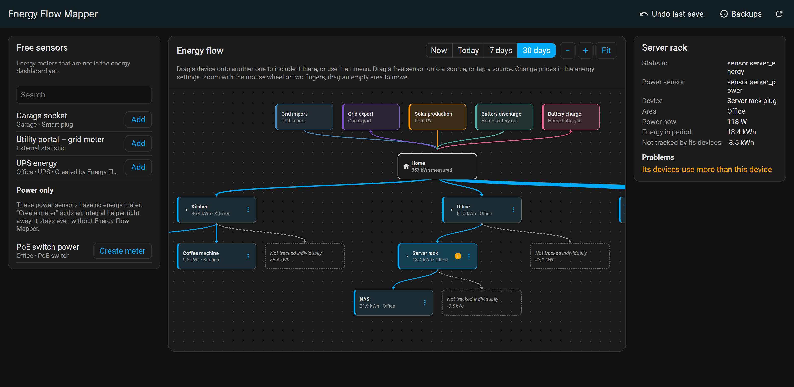 | 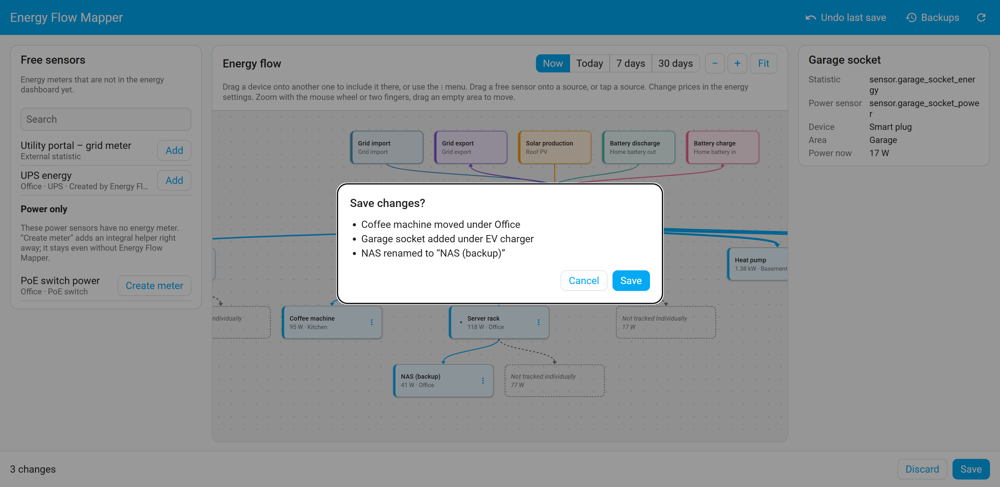 |
| *30 days:* energy per device, untracked consumption, and a warning | *Saving:* every change is listed before anything is written |
| 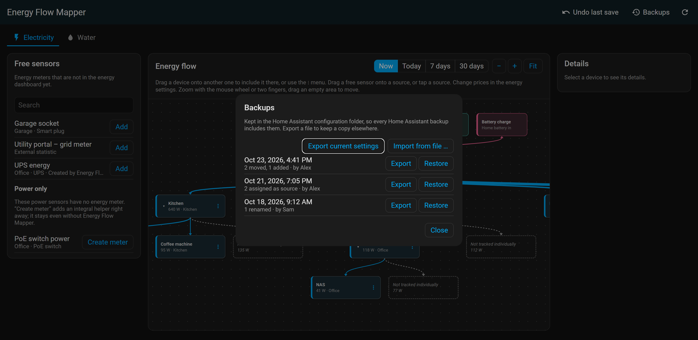 | 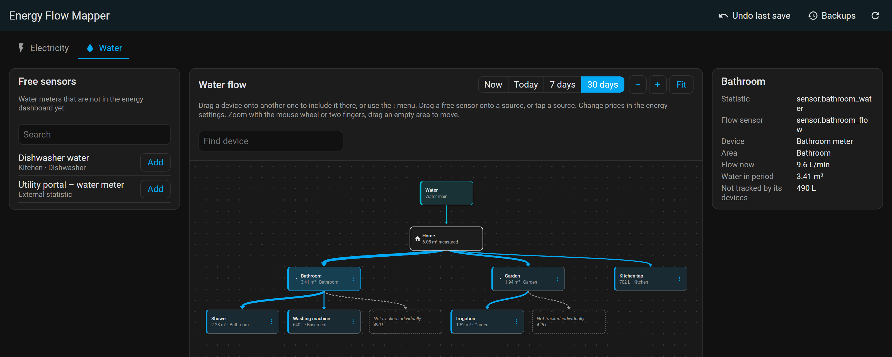 |
| *Backups:* restore, export or import | *Water, 30 days:* litres and m³ per device |
| 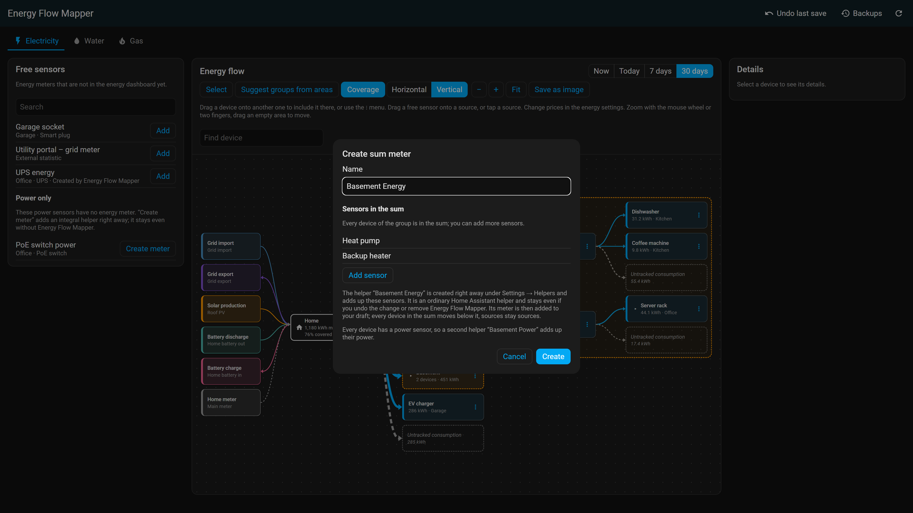 | 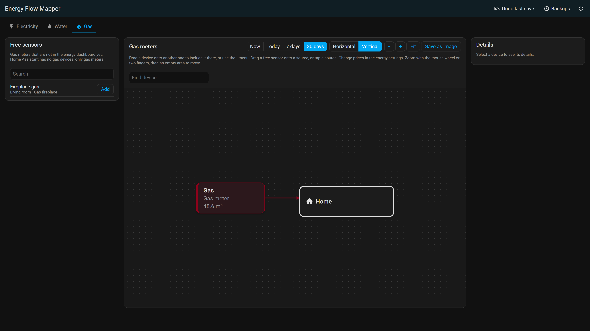 |
| *Sum meter:* turn a group into a real meter | *Gas:* gas meters in their own tab |

<p align="center">
  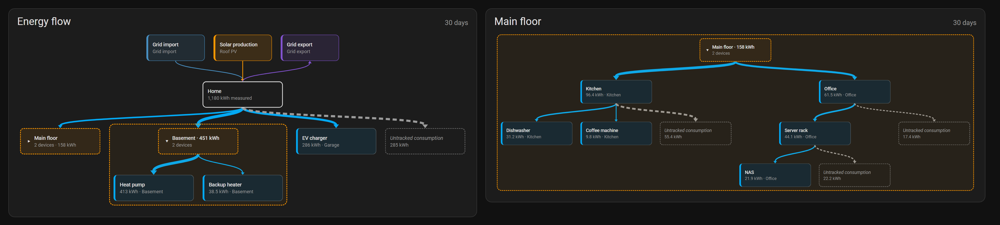
</p>
<p align="center"><sub><i>Dashboard card:</i> groups fold and unfold; <code>root: group:&lt;id&gt;</code> shows just one group.</sub></p>

<p align="center">
  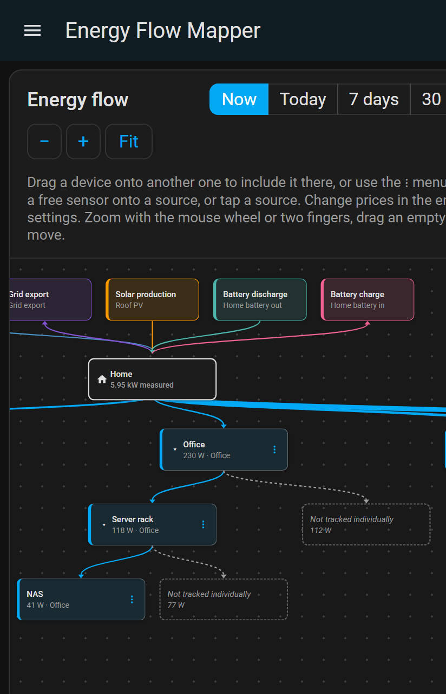
  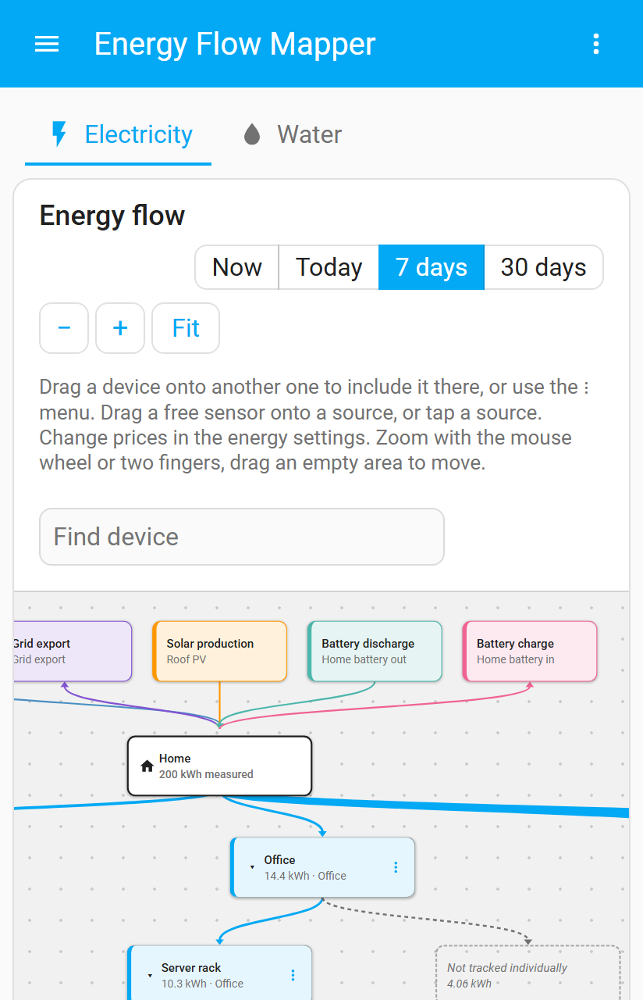
</p>

<p align="center"><sub>The screenshots show a demo household.</sub></p>

## Backups

- **When:** before every save, restore and import, Energy Flow Mapper backs up the
  previous content of the energy settings it changes (sources, devices and/or water
  devices) and of the groups when they change, with the time, the user and a short
  summary.
- **Where:** in `/config/.storage/energy_flow_mapper.backups`, next to Home Assistant's own
  energy settings (`/config/.storage/energy`). Both are part of every **Home Assistant
  backup**, so to keep them off the device, use a Home Assistant backup location such as a
  network share or the cloud.
- **How many:** the last 20 by default; set 5 to 100 in the [options](#options).
- **Restore:** *Undo last save* restores the newest backup, *Backups* → *Restore* any of
  them, groups included. The current settings are backed up first.
- **Export:** *Backups* → *Export current settings* downloads the energy sources,
  devices, water devices and groups as a JSON file; *Export* next to a backup downloads
  that backup. Keep it wherever you like.
- **Import:** *Backups* → *Import from file …* reads such a file, checks it like a draft
  (including what Home Assistant itself would reject) and shows the list of changes
  before anything is written. Only files exported by Energy Flow Mapper are accepted;
  files from 0.2.0 (without water devices) leave the water devices as they are, and files
  from before 0.9.0 (without groups) leave the groups as they are.
- **Removal:** the backups and the groups are deleted with the integration; exported
  files stay.

<details>
<summary><b>How it works</b></summary>

- The energy dashboard configuration of Home Assistant stays the single source of truth.
  Energy Flow Mapper reads it fresh, writes it through the same checks as the energy
  settings page and always sends complete lists, so unrelated settings are kept.
- Backups are stored in `.storage/energy_flow_mapper.backups` (see [Backups](#backups)),
  the list of helpers created by the panel in `.storage/energy_flow_mapper.helpers` and
  what *Solar feeds in here…* made each one for in
  `.storage/energy_flow_mapper.helper_records`, your groups in
  `.storage/energy_flow_mapper.groups`, ignored suggestions and dismissed hints in
  `.storage/energy_flow_mapper.suggestions`.
- The integration has no entities and no devices.
- The card is served with the panel. Its small loader is added to every frontend page;
  the card itself only loads when a dashboard shows it. Its one command only reads the
  device tree, names and consumption, never prices, and is the only command that users
  who are not admins may use.
</details>

<details>
<summary><b>Known limitations</b></summary>

- A device can be included in **one** other device only (a Home Assistant rule).
- Groups are shown by Energy Flow Mapper only; Home Assistant's energy dashboard sees a
  sum meter as a normal device. Everything in a group has the same parent, and there are
  no groups in the Gas tab.
- A member meter that resets to 0 makes a sum meter drop, as with Home Assistant's own
  sensor groups; the energy dashboard may count that as a reset. The sum dialog refuses
  members that start again at 0 now and then, and a hint warns about such a sum made
  elsewhere; a meter that resets only after a power cut or a replacement cannot be told
  in advance.
- *Solar feeds in here…* adds one solar source to one circuit. For a battery or a second
  inverter in the same circuit, build the template helper yourself.
- What a helper set up in YAML is made of is not seen: such a meter is not checked for a
  solar it already holds, for meters it contains, or for counting twice.
- A group used as the card's start point (`root: group:<id>`) opens expanded.
- Prices, costs and solar forecasts are edited in the energy settings of Home Assistant,
  not in the panel.
- Home Assistant has no gas devices, so the *Gas* tab has gas meters only. Gas
  meters that measure energy (kWh) instead of volume are not offered as free gas meters;
  assign them in the energy settings of Home Assistant. The dashboard card does not show
  gas.
- "Create meter" needs a flow in litres, m³, ft³ or gallons per time unit; mL/s has no
  matching water unit.
- An external statistic in m³ is offered as free water meter and as free gas meter; you
  decide what it measures.
- Dragging works with a mouse and with a long press on phones; the ⋮ menu offers the
  same actions.
</details>

<details>
<summary><b>Troubleshooting</b></summary>

- **Repair issue "does not support this Home Assistant release":** the energy settings of
  your Home Assistant release do not match what Energy Flow Mapper expects. To protect
  your settings the editor is disabled. Update Energy Flow Mapper or open an issue.
- **Something looks wrong after saving:** use *Undo last save* or restore a backup.
- **The card shows "Custom element doesn't exist" or an old version** right after
  installing or updating: reload the page. The browser keeps the Home Assistant page
  cached, and the card's loader is part of it.
- **Report a problem:** open an [issue](https://github.com/Skylolerr/ha-energy-flow-mapper/issues)
  with the diagnostics (Settings → Devices & services → Energy Flow Mapper → ⋮ →
  Download diagnostics; it contains counts only, no entity names) and the log entries for
  `energy_flow_mapper`.
</details>

<details>
<summary><b>Removal</b></summary>

Settings → Devices & services → Energy Flow Mapper → ⋮ → **Delete**, then remove it in
HACS. Your energy settings stay as they are, and helpers created by the panel stay too
(delete them under Settings → Helpers if you no longer need them). The backups are
deleted with the integration.
</details>

## Translations

English and German are maintained by the author; French and Italian are new – community
review is welcome.

Missing your language? Open an
[issue](https://github.com/Skylolerr/ha-energy-flow-mapper/issues) and it will gladly be
added. Translations and corrections from users are very welcome, as an issue or a pull
request. The texts are in two places:

- `custom_components/energy_flow_mapper/translations/<language>.json` (setup, options and
  messages; English base: `en.json`)
- `panel/src/translations/<language>.ts` (the panel and the card; English base: `en.ts`)

Copy the English file, translate the texts and keep the keys and `{placeholders}` as they
are. You do not need to build anything; registering the new language is done when it is
merged.

## Support

Energy Flow Mapper is free and open source. If it saves you time, you can
[buy me a coffee](https://buymeacoffee.com/skylolerr) – thank you! A star on GitHub, a
bug report or a translation helps just as much.

<a href="https://buymeacoffee.com/skylolerr"></a>

More of my Home Assistant projects: [skylolerr.com](https://skylolerr.com)

## License

MIT © Skylolerr – see [LICENSE](LICENSE). Changes are listed in the
[changelog](CHANGELOG.md).
