<p align="center">
  <picture>
    <source media="(prefers-color-scheme: dark)" srcset="https://raw.githubusercontent.com/Skylolerr/ha-energy-flow-mapper/main/docs/images/banner-dark.png">
    
  </picture>
</p>

<p align="center">
  <a href="https://hacs.xyz/"></a>
  <a href="https://github.com/Skylolerr/ha-energy-flow-mapper/releases/latest"></a>
  
  <a href="https://github.com/Skylolerr/ha-energy-flow-mapper/actions/workflows/validate.yml"></a>
  <a href="https://github.com/Skylolerr/ha-energy-flow-mapper/actions/workflows/tests.yml"></a>
  <a href="LICENSE"></a>
</p>

<p align="center">
  <a href="https://my.home-assistant.io/redirect/hacs_repository/?owner=Skylolerr&repository=ha-energy-flow-mapper&category=integration"></a>
  <a href="https://my.home-assistant.io/redirect/config_flow_start/?domain=energy_flow_mapper"></a>
</p>

**Not another energy card – a visual editor that maps your sensors into the Home
Assistant energy dashboard.** Energy Flow Mapper shows your energy configuration as a
diagram – sources at the top, your home in the middle, devices below – and lets you
change it by drag and drop: which device is included in which, which sensor is your grid,
solar, battery or water meter, and which meters are not used yet.

> [!NOTE]
> **Beta.** Breaking changes are possible before 1.0. Every save keeps a backup of your
> previous energy settings, so you can always go back.

<p align="center">
  <picture>
    <source media="(prefers-color-scheme: dark)" srcset="https://raw.githubusercontent.com/Skylolerr/ha-energy-flow-mapper/main/docs/images/diagram-dark.png">
    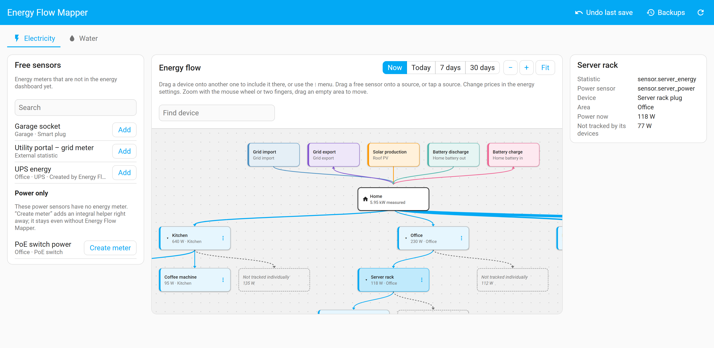
  </picture>
</p>

## See it in action

<table>
  <tr>
    <td width="50%">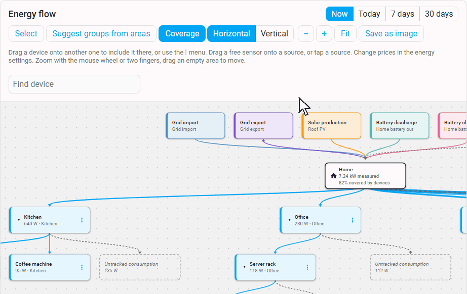</td>
    <td width="50%">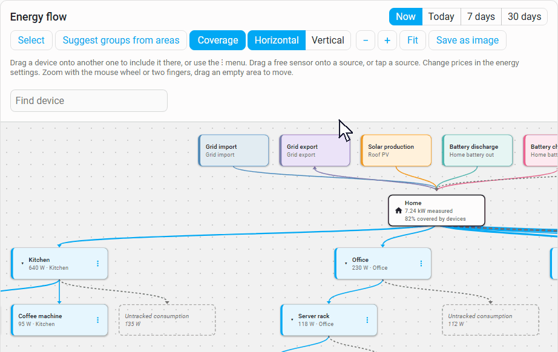</td>
  </tr>
  <tr>
    <td><b>Live and per period.</b> Power now, or energy of today, 7 or 30 days – arrow widths follow the value.</td>
    <td><b>Drag and drop.</b> Drop a device onto another one to include it there; valid targets light up.</td>
  </tr>
  <tr>
    <td colspan="2">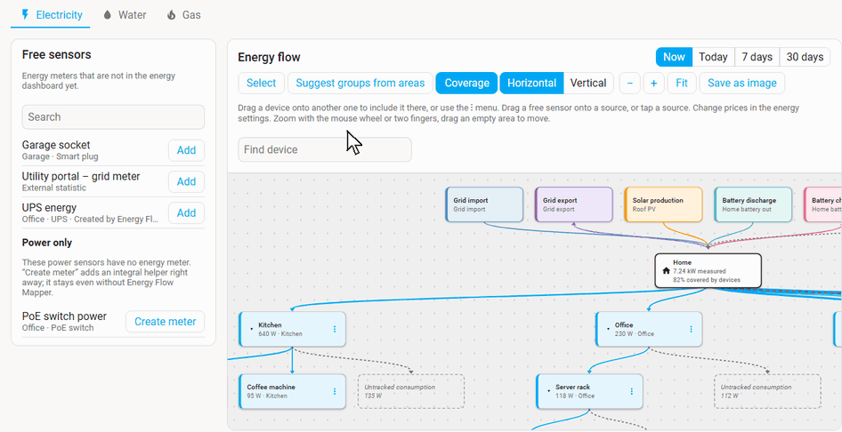</td>
  </tr>
  <tr>
    <td colspan="2"><b>Electricity and water.</b> Each has its own tab with its own devices, meters and free sensors.</td>
  </tr>
  <tr>
    <td colspan="2">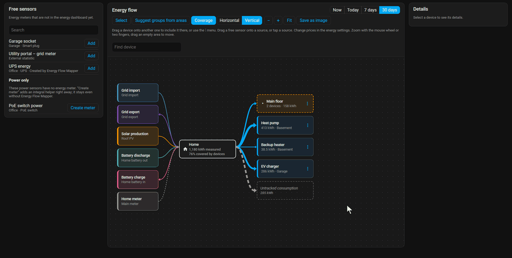</td>
  </tr>
  <tr>
    <td colspan="2"><b>Groups.</b> Select devices, group them, and fold the group into one block with its sum.</td>
  </tr>
</table>

## Features

**See your setup**

- **Diagram of your energy dashboard** – sources, Home and devices, arranged
  automatically; zoom and move with the mouse wheel, by dragging or with two fingers.
  A large tree stays readable: *Vertical* runs it from left to right instead of top-down.
- **Live power and energy per period** – now, today, 7 days or 30 days. Every device with
  child devices shows its *untracked consumption*.
- **The whole home** – Home shows what the house used: measured by a home meter, or
  calculated from grid, solar and battery. Below it, the *untracked consumption* that no device covers yet. With
  Home Assistant 2026.11 or newer you can assign the home meter here too, or turn a
  device into it.
- **Names and terms like Home Assistant** – upstream device, child devices, untracked
  consumption; with Home Assistant 2026.11 or newer, devices are named after their device,
  as in the energy dashboard.
- **Coverage** – Home shows how much of the house the devices cover, for example
  *72% covered by devices*. Switch it off with *Coverage* above the diagram.
- **Home Assistant's own checks** – what the energy settings of Home Assistant report
  (sensor unavailable, entity gone, wrong unit, …) is marked right at the block, in Home
  Assistant's own words.
- **Plausibility warnings** – a device is flagged when its child devices used clearly more
  than it did (more than 5 % and 0.1 kWh, water 10 L) – usually a wrong assignment.
- **Find a device** – the search field highlights matches, opens collapsed devices and
  moves to them.
- **Groups** – bundle devices of the same parent into named groups, nested as deep as you
  like. A collapsed group is one block with the sum of its members; expanded, it is a
  labelled frame. Handy for big, flat trees (electricity and water).

**Change it safely**

- **Drag and drop** (or the ⋮ menu on phones) – include a device in another one, move it to
  the top level, rename or remove it.
- **Sources** – drop a sensor onto grid import, grid export, solar, battery, water or gas.
  Prices and compensations of an existing source stay as they are.
- **Free sensors** – energy and water meters and external statistics (for example from
  your supplier's portal) that are not in the dashboard yet, added with one drag.
- **Meters for power and flow sensors** – "Create meter" turns a power sensor (a UPS, PoE
  ports, …) or a flow sensor into an ordinary integral helper and puts it in the diagram.
- **Suggestions from child devices** – where an integration registers a device as part of
  another one (an outlet of a power strip, a channel of a multi-channel meter), the panel
  suggests including it there. *Apply* puts it into the draft, *Ignore* hides it for every
  admin. Nothing changes by itself, and connections such as a Zigbee stick never count.
- **Sum meters** – *Create sum meter* turns a group (or sensors you pick, for example a
  sub panel plus its solar) into a real Home Assistant sum helper that becomes a device
  in the energy dashboard, with the members below it.
- **Draft, check, save** – changes are collected in a draft and checked (loops, missing
  parents, duplicates, a sensor used twice) before anything is written. *Undo change*
  takes back a step, and every save stores a backup first. Leave the panel and come back:
  your unsaved draft is still there.

**Everywhere**

- **Dashboard card** – the same tree, read-only, on any dashboard and for every user;
  groups open and close by tapping, and the card can start at a group.
- **Save as image** – the whole diagram as a PNG for a question, a forum post or your own
  records; *Hide names* turns devices into *Device 1, 2, …* and leaves out areas and
  sensor names. The image is made in your browser and sent nowhere.
- **Water tab** – water devices and meters, in litres and m³ (gallons with US units).
- **Gas tab** – your gas meters with their use, in m³ (ft³ with US units) or kWh; assign,
  replace and remove them. Home Assistant has no gas devices, so there is nothing to
  arrange below them.
- **Backups, export and import** – restore any earlier state or keep a copy elsewhere.
- **English, German, French and Italian**, light and dark theme, phone layout.

## Installation

1. **HACS:** open HACS, search for **Energy Flow Mapper**, download it and restart Home
   Assistant. *Open this repository in HACS* above takes you straight there.
2. **Set up:** click *Set up Energy Flow Mapper* above, or Settings → Devices & services →
   **Add integration** → **Energy Flow Mapper**.
3. **Open the panel:** **Energy Flow Mapper** appears in the sidebar for admins. The setup
   itself does not change your energy settings.

Requires Home Assistant **2026.10.0** or newer. The panel is for admins; the dashboard
card is for everyone.

<details>
<summary>As a custom repository</summary>

If HACS does not find it yet, add `https://github.com/Skylolerr/ha-energy-flow-mapper`
under HACS → ⋮ → **Custom repositories** with type **Integration**, then download
**Energy Flow Mapper** and restart Home Assistant.
</details>

<details>
<summary>Manual installation</summary>

Copy `custom_components/energy_flow_mapper` into the `custom_components` folder of your
Home Assistant configuration and restart Home Assistant.
</details>

### Options

Settings → Devices & services → Energy Flow Mapper → **Configure**:

| Option | Default | Meaning |
|---|---|---|
| Backups to keep | 20 | How many backups of your previous energy settings are kept, 5 to 100. If you lower it, the oldest backups beyond the new number are deleted. |

## Dashboard card

<p align="center">
  <picture>
    <source media="(prefers-color-scheme: dark)" srcset="https://raw.githubusercontent.com/Skylolerr/ha-energy-flow-mapper/main/docs/images/card-dark.png">
    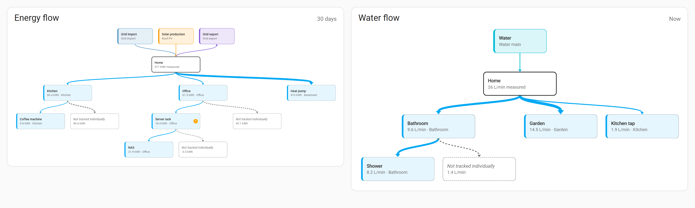
  </picture>
</p>

The card shows a device tree on a dashboard. It only shows – editing stays in the panel –
and every user who can see the dashboard sees it, like Home Assistant's own energy
dashboard. Tap a device to open its history.

Add it in the dashboard editor: *Add card* → search for **Energy Flow Mapper**. It comes
with the integration; there is no resource to add. In YAML:

```yaml
type: custom:energy-flow-mapper-card
kind: electricity      # or water
period: today          # now, today, week or month
root: sensor.kitchen_energy   # optional: only this device (or group:<id>) and everything below it
title: Kitchen         # optional; an empty title hides the header
orientation: vertical  # horizontal (top-down, default) or vertical (left to right)
show_sources: true     # sources before Home (not with root)
show_untracked: true   # blocks for untracked consumption
show_coverage: false   # "72% covered by devices" at Home (electricity, off by default)
```

A tree wider than the card is shown at half size at least; then the card scrolls
sideways and starts at Home. With many devices, `vertical` keeps the tree narrow and
makes the card taller. Values are read again every minute; power and flow *now* follow
the sensors live.

## Using the panel

| To … | Do this |
|---|---|
| Include a device in another one | Drag its block onto the other block, or ⋮ → *Move to …* |
| Move a device to the top level | Drag it onto **Home**, or ⋮ → *Move to …* → *Top level* |
| Add a meter as device | Drag it from *Free sensors* into the diagram, or *Add* |
| Assign a source | Drag a free sensor onto *+ Grid import*, *+ Solar*, … or tap the source |
| Replace or remove a source | Tap the source block |
| Edit water devices and meters | Open the *Water* tab; everything works as for electricity |
| Assign, replace or remove a gas meter | Open the *Gas* tab; *Add* a free gas meter or tap the meter |
| Get a meter for a power sensor | *Power only* → *Create meter* |
| Get a water meter for a flow sensor | *Water* tab → *Flow only* → *Create meter* |
| Group devices | Ctrl/Cmd+click several blocks (on a phone: *Select*, then tap them) → *Group* → name |
| Add a device to a group | Drag its block onto the group |
| Take a device out of a group | Drag it out of the frame onto its parent |
| Rename or dissolve a group | Tap the group → *Rename* or *Dissolve group* (members stay) |
| Group devices by area | *Suggest groups from areas* in the toolbar |
| Create a sum meter | Tap a group → *Create sum meter*, or ⋮ on a device to pick sensors freely |
| Show one group on a dashboard | Card option `root: group:<id>`, or pick the group in the card editor |
| Find a device in a big diagram | Type in *Find device*; Enter goes to the next match |
| Take back a change of the draft | *Undo change* in the bar at the bottom, or Ctrl+Z |
| See energy instead of power | Switch *Now* to *Today*, *7 days* or *30 days* |
| Use a suggestion | Tap the device with the light bulb → *Apply* (or *Ignore*) |
| Share or keep a picture | *Save as image*, optionally with *Hide names* |
| Save | *Save* in the bar at the bottom, check the list of changes, confirm |
| Go back | *Undo last save* or *Backups* → *Restore* |
| Keep a copy elsewhere | *Backups* → *Export current settings*, or *Export* next to a backup |
| Bring a copy back | *Backups* → *Import from file …*, check the list of changes, confirm |

> [!TIP]
> **Nothing is written until you save.** The bar at the bottom shows how many changes your
> draft has; *Undo change* takes back the last one, *Discard* throws the draft away.

<details>
<summary>Good to know</summary>

- **"Create meter" acts at once:** the integral helper is created immediately (not on
  save) and appears under Settings → Helpers. It is an ordinary Home Assistant helper and
  keeps working without Energy Flow Mapper; the panel labels helpers it created. Undoing
  the change in the draft does not delete the helper; it stays a free sensor. A water
  meter counts in the unit of the flow (L/min gives litres, m³/h gives m³) and is shown
  as water, so the energy dashboard accepts it.
- **Energy values** come from the Home Assistant statistics, like in the energy
  dashboard: *Today* is at most a few minutes old, *7 days* and *30 days* go up to the
  last full hour. New meters only have values from the time they were created.
- If someone changes the energy settings elsewhere while you edit, saving is refused and
  the panel reloads; your draft is kept and checked again.
- **Groups exist only in Energy Flow Mapper.** Home Assistant's energy dashboard does not
  know them; it only sees a sum meter as a normal device. Groups are display only and are
  stored in `.storage/energy_flow_mapper.groups`; they are included in backups and in
  exports.
- **Sum meters act at once, too:** the helpers are created immediately (not on save) and
  appear under Settings → Helpers; undoing the draft leaves them in place. They are Home
  Assistant sum helpers with *ignore non-numeric* off. Mixed Wh and kWh members are
  converted by Home Assistant; members with different state classes are refused, and so
  are external statistics (a helper cannot sum them). A power or flow sum is created
  only when every device in the sum has a power or flow sensor.
- **Your draft survives leaving the panel:** the browser keeps it until you save or
  discard it. If the energy settings were changed in the meantime, it cannot be applied
  any more and is dropped with a message. After a save conflict the panel reloads, keeps
  the draft and stores it for the new settings. A kept draft brings back its undo steps;
  older drafts without them come back one change per step.
- **When saving is not possible,** the bar at the bottom says how many problems prevent
  it. The check before saving lists them, marks problems that are already in the saved
  settings, and *Show* takes you to the block.
</details>

## Screenshots

| | |
|---|---|
| 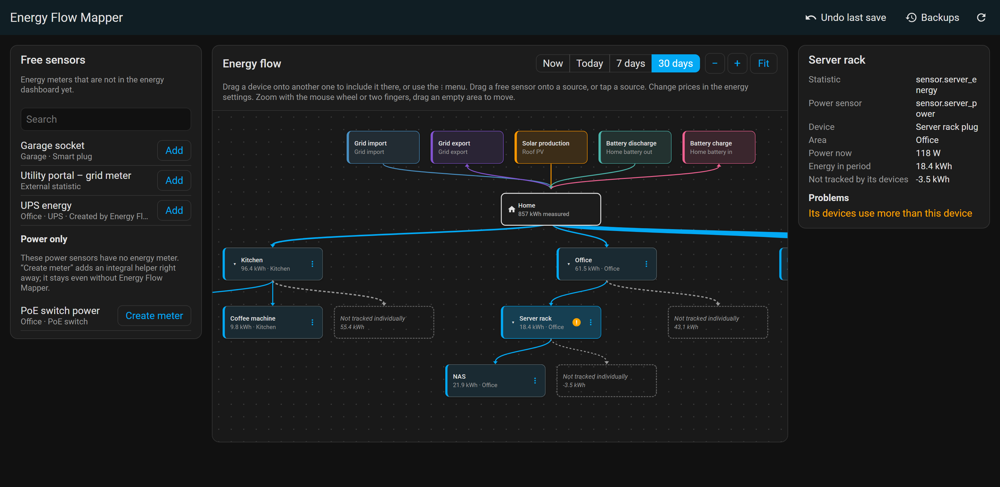 | 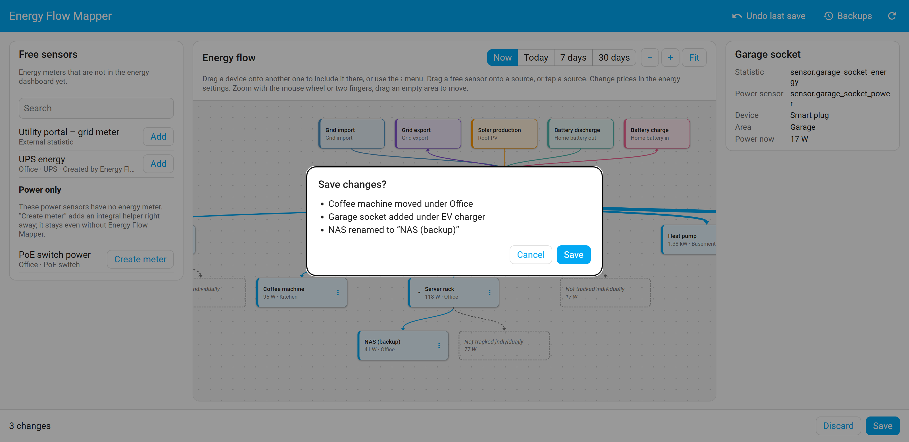 |
| *30 days:* energy per device, untracked consumption, and a warning | *Saving:* every change is listed before anything is written |
| 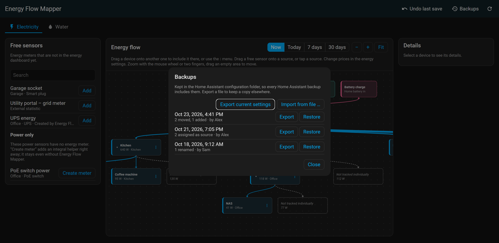 | 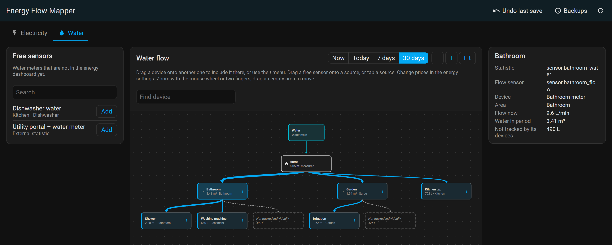 |
| *Backups:* restore, export or import | *Water, 30 days:* litres and m³ per device |
| 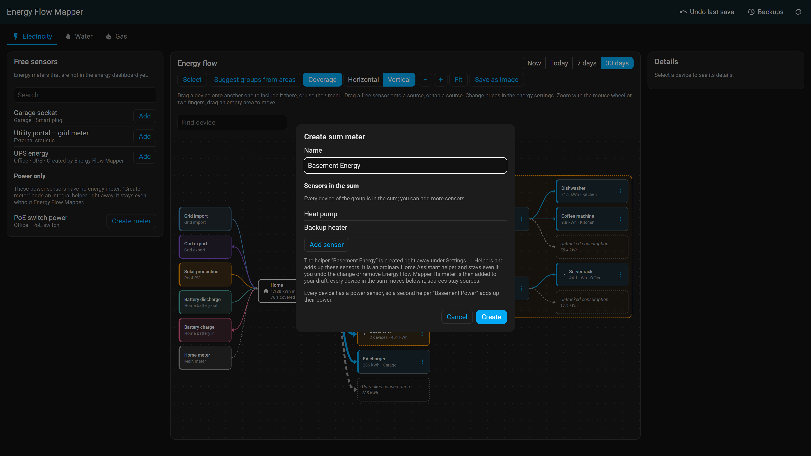 | 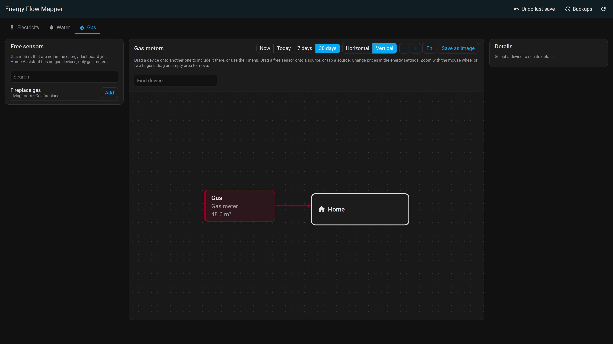 |
| *Sum meter:* turn a group into a real meter | *Gas:* gas meters in their own tab |

<p align="center">
  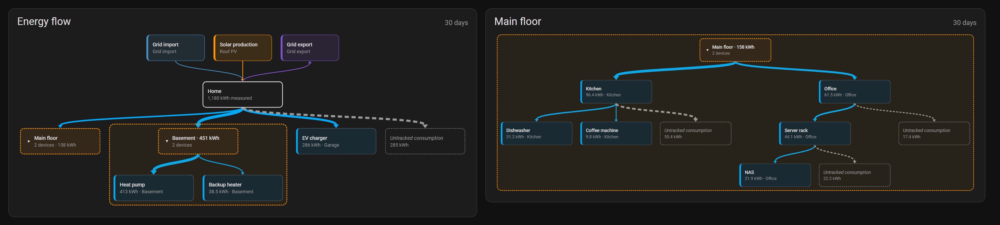
</p>
<p align="center"><sub><i>Dashboard card:</i> groups fold and unfold; <code>root: group:&lt;id&gt;</code> shows just one group.</sub></p>

<p align="center">
  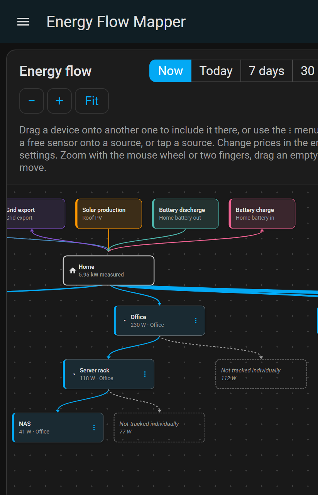
  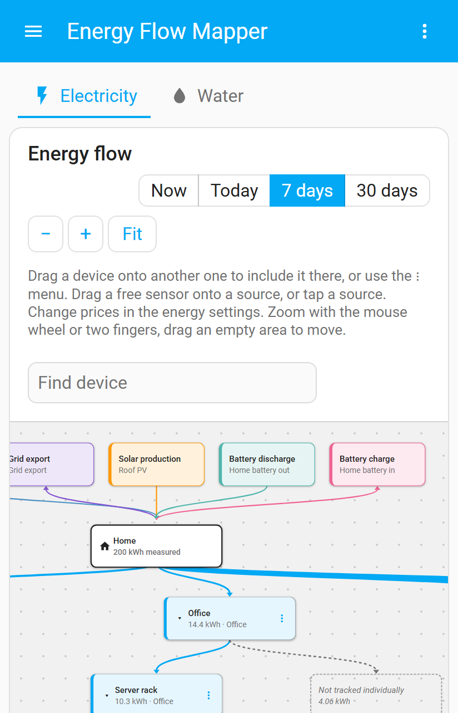
</p>

<p align="center"><sub>The screenshots show a demo household.</sub></p>

## Backups

- **When:** before every save, restore and import, Energy Flow Mapper backs up the
  previous content of the energy settings it changes (sources, devices and/or water
  devices) and of the groups when they change, with the time, the user and a short
  summary.
- **Where:** in `/config/.storage/energy_flow_mapper.backups`, next to Home Assistant's own
  energy settings (`/config/.storage/energy`). Both are part of every **Home Assistant
  backup**, so to keep them off the device, use a Home Assistant backup location such as a
  network share or the cloud.
- **How many:** the last 20 by default; set 5 to 100 in the [options](#options).
- **Restore:** *Undo last save* restores the newest backup, *Backups* → *Restore* any of
  them, groups included. The current settings are backed up first.
- **Export:** *Backups* → *Export current settings* downloads the energy sources,
  devices, water devices and groups as a JSON file; *Export* next to a backup downloads
  that backup. Keep it wherever you like.
- **Import:** *Backups* → *Import from file …* reads such a file, checks it like a draft
  (including what Home Assistant itself would reject) and shows the list of changes
  before anything is written. Only files exported by Energy Flow Mapper are accepted;
  files from 0.2.0 (without water devices) leave the water devices as they are, and files
  from before 0.9.0 (without groups) leave the groups as they are.
- **Removal:** the backups and the groups are deleted with the integration; exported
  files stay.

<details>
<summary><b>How it works</b></summary>

- The energy dashboard configuration of Home Assistant stays the single source of truth.
  Energy Flow Mapper reads it fresh, writes it through the same checks as the energy
  settings page and always sends complete lists, so unrelated settings are kept.
- Backups are stored in `.storage/energy_flow_mapper.backups` (see [Backups](#backups)),
  the list of helpers created by the panel in `.storage/energy_flow_mapper.helpers`, your
  groups in `.storage/energy_flow_mapper.groups`.
- The integration has no entities and no devices.
- The card is served with the panel. Its small loader is added to every frontend page;
  the card itself only loads when a dashboard shows it. Its one command only reads the
  device tree, names and consumption, never prices, and is the only command that users
  who are not admins may use.
</details>

<details>
<summary><b>Known limitations</b></summary>

- A device can be included in **one** other device only (a Home Assistant rule).
- Groups are shown by Energy Flow Mapper only; Home Assistant's energy dashboard sees a
  sum meter as a normal device. Everything in a group has the same parent, and there are
  no groups in the Gas tab.
- A member meter that resets to 0 makes a sum meter drop, as with Home Assistant's own
  sensor groups; the energy dashboard may count that as a reset.
- A group used as the card's start point (`root: group:<id>`) opens expanded.
- Prices, costs and solar forecasts are edited in the energy settings of Home Assistant,
  not in the panel.
- Home Assistant has no gas devices, so the *Gas* tab has gas meters only. Gas
  meters that measure energy (kWh) instead of volume are not offered as free gas meters;
  assign them in the energy settings of Home Assistant. The dashboard card does not show
  gas.
- "Create meter" needs a flow in litres, m³, ft³ or gallons per time unit; mL/s has no
  matching water unit.
- An external statistic in m³ is offered as free water meter and as free gas meter; you
  decide what it measures.
- Dragging works with a mouse and with a long press on phones; the ⋮ menu offers the
  same actions.
</details>

<details>
<summary><b>Troubleshooting</b></summary>

- **Repair issue "does not support this Home Assistant release":** the energy settings of
  your Home Assistant release do not match what Energy Flow Mapper expects. To protect
  your settings the editor is disabled. Update Energy Flow Mapper or open an issue.
- **Something looks wrong after saving:** use *Undo last save* or restore a backup.
- **The card shows "Custom element doesn't exist" or an old version** right after
  installing or updating: reload the page. The browser keeps the Home Assistant page
  cached, and the card's loader is part of it.
- **Report a problem:** open an [issue](https://github.com/Skylolerr/ha-energy-flow-mapper/issues)
  with the diagnostics (Settings → Devices & services → Energy Flow Mapper → ⋮ →
  Download diagnostics; it contains counts only, no entity names) and the log entries for
  `energy_flow_mapper`.
</details>

<details>
<summary><b>Removal</b></summary>

Settings → Devices & services → Energy Flow Mapper → ⋮ → **Delete**, then remove it in
HACS. Your energy settings stay as they are, and helpers created by the panel stay too
(delete them under Settings → Helpers if you no longer need them). The backups are
deleted with the integration.
</details>

## Translations

English and German are maintained by the author; French and Italian are new – community
review is welcome.

Missing your language? Open an
[issue](https://github.com/Skylolerr/ha-energy-flow-mapper/issues) and it will gladly be
added. Translations and corrections from users are very welcome, as an issue or a pull
request. The texts are in two places:

- `custom_components/energy_flow_mapper/translations/<language>.json` (setup, options and
  messages; English base: `en.json`)
- `panel/src/translations/<language>.ts` (the panel and the card; English base: `en.ts`)

Copy the English file, translate the texts and keep the keys and `{placeholders}` as they
are. You do not need to build anything; registering the new language is done when it is
merged.

## Support

Energy Flow Mapper is free and open source. If it saves you time, you can
[buy me a coffee](https://buymeacoffee.com/skylolerr) – thank you! A star on GitHub, a
bug report or a translation helps just as much.

<a href="https://buymeacoffee.com/skylolerr"></a>

More of my Home Assistant projects: [skylolerr.com](https://skylolerr.com)

## License

MIT © Skylolerr – see [LICENSE](LICENSE). Changes are listed in the
[changelog](CHANGELOG.md).
